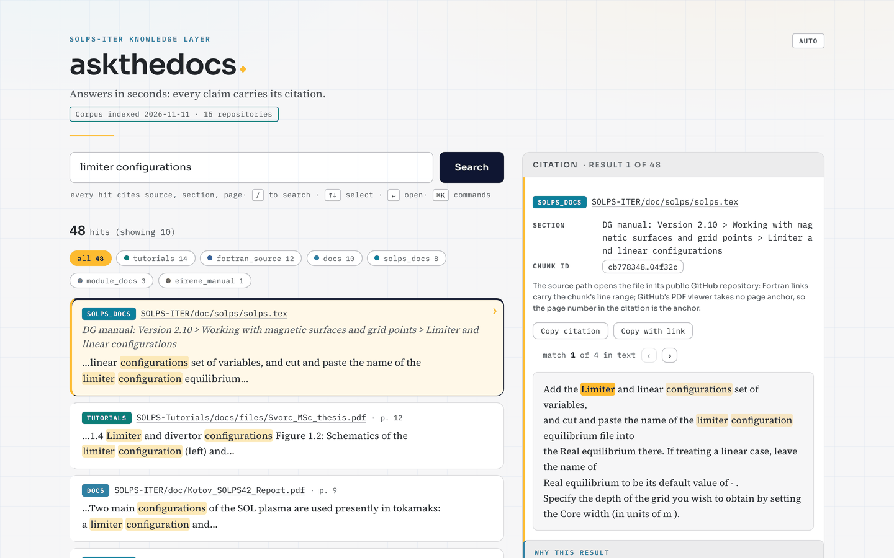
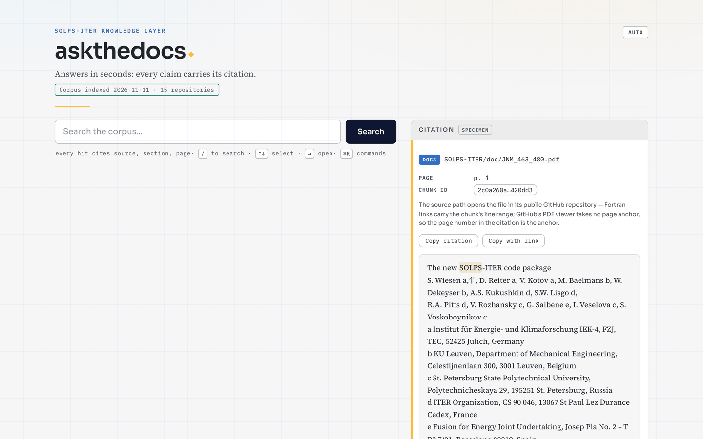

# askthedocs: answers in seconds, with citations

A knowledge layer over the SOLPS-ITER documentation corpus. Manuals, tutorials, the changelog, and every Fortran procedure are indexed into one searchable store. Every answer carries its citation, with a one-click deep link to the exact passage.



One install, three faces: a web app, a CLI, and MCP tools. One engine and one ranking behind all three. An answer looks the same on every face.

## Quick start

Python >= 3.10. The prerequisite is the repository this folder lives in: a SOLPS-ITER clone with its submodules initialized (`adas` excepted; it is pinned non-public). The optional documentation repositories (SOLPS-GUI, SOLPS-Tutorials) join the index when cloned beside it. From the clone root:

```sh
python3 -m venv .venv
.venv/bin/pip install tools/askthedocs
.venv/bin/askthedocs setup            # builds the index, at most 6 minutes
```

`setup` checks the checkout, then builds the index into `~/.local/share/askthedocs/` and installs the desktop icon. That location is outside every checkout. Every face finds it from any directory; no configuration is necessary. Re-runs report freshness and never rebuild silently. `setup --force` rebuilds on demand; `setup --no-icon` builds without the icon.

The icon opens the web version: the full certified app, one gesture, no terminal. It lands in your platform's launcher, all user-level, no administrator needed. `askthedocs shortcut --remove` takes it back out:

| OS | The icon lands |
|---|---|
| macOS | a generated `.app` under `~/Applications` |
| Linux | a `.desktop` entry in `~/.local/share/applications` |
| Windows | a `.cmd` in the per-user Start Menu |

**Windows.** Every command in this README applies with the venv's Scripts directory in place of bin: `.venv\Scripts\askthedocs` wherever you read `.venv/bin/askthedocs` (`py -3 -m venv .venv` creates the venv). That one translation rule covers them all.

### If it refuses

Every refusal is loud and names its own fix. The three you might meet on day one:

- **The checkout is missing or half-initialized:** `setup` refuses and lists the submodule states with the missing ones named.
- **No index yet:** every read face (search, web, MCP) refuses and points at `askthedocs setup`.
- **No FTS5 in your Python:** named as such; standard python.org installers and mainstream distributions ship it.

## Three ways in

**Web.** Click the icon, or run `.venv/bin/askthedocs open`. The service listens on `127.0.0.1:8000` and serves the certified client from the install.



**Terminal.** Ranked hits with citations, passages by id, freshness on demand:

```sh
.venv/bin/askthedocs search "limiter configurations"   # ranked hits, phrase-tier marked
.venv/bin/askthedocs search b2mndr_stim                # exact switch name ranks first
.venv/bin/askthedocs show <chunk_id>                   # full passage + provenance
.venv/bin/askthedocs status                            # corpus drifted since the build?
```

**Assistants.** askthedocs speaks MCP: two tools, `search_docs` (corpus search with citations) and `get_chunk` (the full passage behind a hit). The standard wiring needs no environment. One-line registration, user scope, stdio:

```sh
<your-client> mcp add --scope user askthedocs \
  -- /full/path/to/venv/bin/askthedocs-mcp
```

The full wiring recipes, for every client kind, are in the manual.

## What it can do

**Search that understands the corpus.**

- Every hit carries its citation: source, section, page.
- While you type, you see results for exactly what is typed, plus real corpus-word suggestions.
- Zero hits? The index offers words that extend yours, each with its true result count.
- Singular and plural match each other automatically.
- Documents with your words as an adjacent phrase rank first.
- A query naming a switch or procedure ranks its own entry first.
- Quoted phrases for exact work. Raw FTS5 syntax for power users. Invalid syntax falls back to plain terms.
- Filter any result set by cluster: manuals, tutorials, Fortran, switches, and more.

**Reading and citing.**

- The passage pane shows the full text with its provenance.
- One click copies the citation, a restoring deep link, or the chunk id.
- The chunk id is a deep link. Fetch any passage by id alone, from any face.

**The corpus, kept honest.**

- `status` re-hashes the corpus and reports current or drifted, per repository.
- The corpus modal shows every repository at its pinned commit.
- Rebuild from the web: evidence-carrying confirmations, live progress, search answering throughout.

Every point above is documented task by task, with screenshots, in the manual.

## The manual

The deep guide is **askthedocs-Manual.md**, beside this file. A screenshot at every step.

## License

Maintained by Alfonso Sacco.

EUPL-1.1, Copyright 2026 Alfonso Sacco; see `LICENSE.md`. The web client bundles OFL-licensed fonts and MIT-licensed Svelte runtime code; their notices travel in `web/THIRD-PARTY-NOTICES.md`.
