# The askthedocs manual

This is the deep guide. The quick start lives in the README beside this file.

askthedocs is a knowledge layer over the SOLPS-ITER documentation corpus. Manuals, tutorials, the changelog, and every Fortran procedure are extracted into one chunk store. Every answer carries its citation, with a one-click deep link to the exact passage. One engine, one ranking, three faces: web, terminal, and assistant.

## Contents

1. [Set it up](#1-set-it-up)
2. [Search and read](#2-search-and-read)
3. [Ask an assistant](#3-ask-an-assistant)
4. [Work from the terminal](#4-work-from-the-terminal)
5. [Know what is indexed](#5-know-what-is-indexed)
6. [Keep the index fresh](#6-keep-the-index-fresh)
7. [Under the hood](#7-under-the-hood)

## 1. Set it up

### What you receive

One package: the search engine, the CLI, the HTTP service with the certified web client, and the MCP face. The search index is not shipped. `setup` builds it once, on your machine, from the clone you already have. The index always matches the repositories in front of you.

### Prerequisites

Python 3.10 or newer. The repository this folder lives in: a clone of SOLPS-ITER with its submodules initialized. The `adas` submodule is excepted. It is pinned non-public, and nobody can initialize it. The optional documentation repositories, SOLPS-GUI and SOLPS-Tutorials, join the index when cloned beside the checkout.

### The three commands

From the clone root:

```sh
python3 -m venv .venv
.venv/bin/pip install tools/askthedocs
.venv/bin/askthedocs setup            # builds the index, at most 6 minutes
```

The line above runs from the clone root. From inside `tools/` the same install reads `pip install ./askthedocs`. The packages are not on PyPI, so pip always needs the folder path; the bare name cannot resolve.

The virtual environment is the isolation guarantee. Everything this package needs installs inside `.venv`, so nothing it installs can affect any other Python on the machine, and no package held by any other Python can affect it. The one case a private environment cannot cover is a property of the interpreter itself, not of its packages; the FTS5 paragraph below names it and its remedies.

`setup` also probes the Python's SQLite for the FTS5 extension the index needs. Cluster Pythons are sometimes built without it; on Linux x86_64 the fallback wheel installs automatically with this package, and elsewhere the refusal names the one-command remedy (`pip install pysqlite3-binary`). No administrator is needed on any path.

`setup` first checks the checkout. A missing or half-initialized clone is refused loudly, with the remedy named. It then builds the search index into the per-user location and installs the desktop icon. Over the full corpus set, the one-time build takes at most 6 minutes.

Re-runs never rebuild silently. They re-hash the corpus and report freshness. Use `askthedocs setup --force` to rebuild on demand. Use `askthedocs setup --no-icon` to build without the icon.

**Windows.** Every command in this manual applies with the venv's Scripts directory in place of bin: `.venv\Scripts\askthedocs` wherever you read `.venv/bin/askthedocs`. The command `py -3 -m venv .venv` creates the venv. That one translation rule covers everything.

### Where the index lands

The index lives at `~/.local/share/askthedocs/`. That is outside every checkout. It is found from any directory, and it survives re-clones. The CLI, the web version, and MCP all find the index automatically. No configuration is necessary.

Home filesystems are often quota-limited, and an index over the full corpus is large. One redirect moves all of it, wholesale: pass `--home /scratch/wherever` to `askthedocs setup`, `search`, `show`, or `status`, or export `ASKTHEDOCS_HOME=/scratch/wherever` in your shell. A build into a moved home also records the location: setup writes one small line into the default folder, and every face — the service included, started from any shell without the variable — finds the moved index from then on. No export is needed for the program's own faces; the variable remains the per-shell override, and it wins over the record. An existing index moves without rebuilding: `mv ~/.local/share/askthedocs /scratch/`, then either export `ASKTHEDOCS_HOME=/scratch/askthedocs` or record the new location once (`mkdir -p ~/.local/share/askthedocs && echo /scratch/askthedocs > ~/.local/share/askthedocs/index-home.txt`). The desktop icon picks the location up the next time `setup` runs. The read order never changes: `ASKTHEDOCS_DB` (one database file, verbatim) still wins, the launch-directory `./askthedocs-db/` still comes next, and the index home answers third — with the recorded location standing in for the default whenever the record points somewhere that exists (a stale record is simply ignored). When the home points somewhere empty while an index sits in the default location, the refusal names that index and the two ways back: drop the redirect, or move the index.

A store is validated when found: readable SQLite, the expected schema, and FTS5 in your Python. Any failure names the exact problem. If no index exists yet, every face refuses loudly and names `askthedocs setup` as the fix.

### The icon

| OS | The icon lands | Take it back out |
|---|---|---|
| macOS | a generated `.app` under `~/Applications` | `.venv/bin/askthedocs shortcut --remove` |
| Linux | a `.desktop` entry in `~/.local/share/applications` | `.venv/bin/askthedocs shortcut --remove` |
| Windows | a `.cmd` in the per-user Start Menu | `.venv/bin/askthedocs shortcut --remove` |

The icon is all user-level. No administrator is needed.

### When setup completes

It prints the totals: chunks by origin, split into documents, switch entries, and procedures. When a file could not be read, it prints one further line: how many sources were skipped, their names, and where the reasons are recorded (`build_summary.json`, beside the index). A skipped file is rare: it means the file is not valid UTF-8 text or is otherwise unreadable, and the rest of the corpus is indexed without it. It prints where the index landed; when the index home is redirected, it prints the home and the one `export` line that makes every face find it. It prints the three doors: the web version, a terminal search, and MCP.

### If it refuses

Every refusal is loud and names its own fix. The four you might meet on day one:

- **The checkout is missing or half-initialized:** `setup` refuses and lists the submodule states with the missing ones named. The remedy: initialize the submodules in your clone.
- **No index yet:** every read face refuses and points at `askthedocs setup`.
- **The index home points somewhere empty:** the refusal names the index it is not reading and the two ways back (drop the redirect, or move the index).
- **No FTS5 in your Python:** named as such. Standard python.org installers and mainstream distributions ship it.

Each message states its remedy. Following it is the whole procedure.

## 2. Search and read

### Get in with one click

The icon opens the web version: the full certified app, not a reduced launcher view. You get the same interface you would have by starting the service yourself. The search box, the ranked hits with their citations, the passage pane, the corpus modal with its per-repository statuses: everything is there. The shortcut is not a second product. It is the web product with its start-up cost removed.

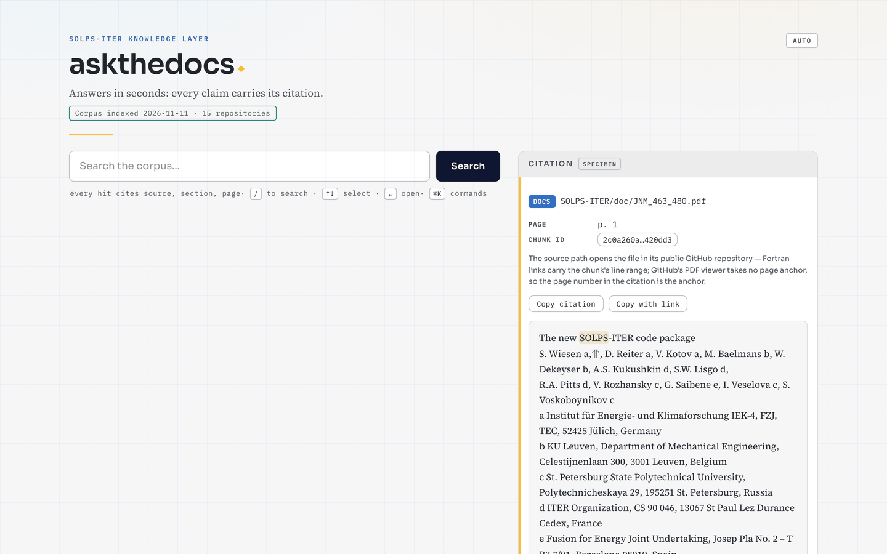

Why this is the most efficient way in:

- **One gesture, always works:** a click from the Dock on macOS, the Start menu on Windows, or the launcher on Linux. No terminal, no URL to remember, never a dead bookmark. A URL only works when the server is already up; the click makes it be up.
- **Zero administration at use time:** the index lives in the per-user share, and `setup` records the corpus root beside it. The click needs nothing carried. The service starts only when none is running.
- **The full research loop, eyes-first:** type, read, open the passage, copy the citation. The same engine and the same ranking as the terminal and assistant faces. Nothing is lost by choosing the readable one.
- **Maintenance lives in the same app:** the index status button and the reindex button cover the corpus-care loop too. No terminal needed.

The command underneath the icon is `.venv/bin/askthedocs open`. If the service is already up, it just opens the app. If not, it starts the service detached, prints the log's location, waits for it to answer, and opens the app. It is idempotent: run it as often as you like.

The service listens on `127.0.0.1:8000` and serves the certified client from the install. A click never restarts a running service.

`.venv/bin/askthedocs open --restart` is the explicit convergence verb for a rare context change. It stops a running service and starts a fresh one carrying the current context. It refuses while a rebuild is in flight: nobody restarts into a rebuild on purpose. It is never needed for the corpus itself: a rebuild's new store swaps live inside the running service. A restart is only for a deliberate change of environment.

### Type, and watch the corpus answer

Start typing. From the third character of your last word, the page answers in two tiers. The upper tier holds results for exactly what you have typed, in the order committing would produce. The lower tier holds marked suggestions: real corpus words that extend your unfinished word, each with its true result count. Committing keeps the upper tier verbatim and drops only the suggestions.

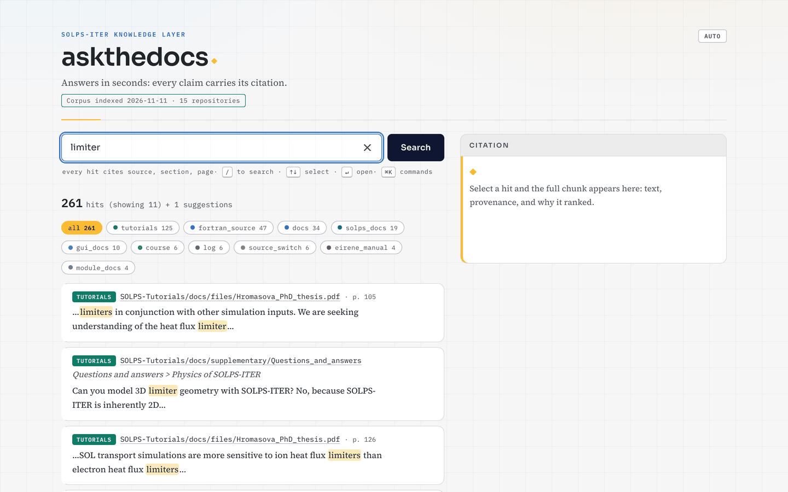

### Zero hits, with a way out

A search can come back empty because the last word is unfinished or wrong. The page then offers real corpus words instead of silence. The most promising extension is highlighted as a did-you-mean. Every offered word carries the exact count that clicking it yields. No fuzzy guessing: every number comes from the index.

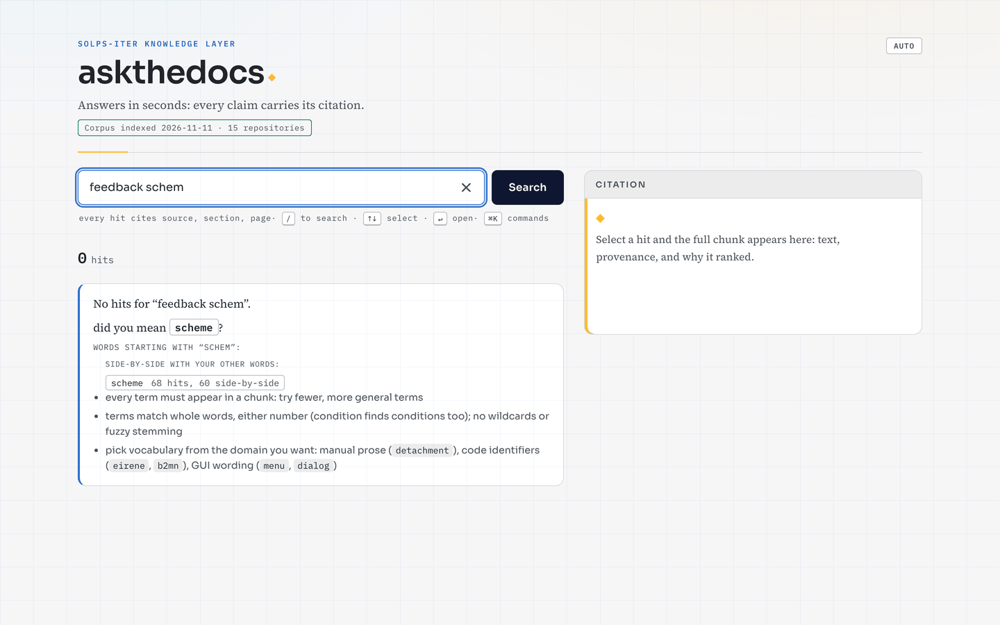

### Narrow by cluster

Every result set carries filter buttons, one per cluster: manuals, tutorials, Fortran procedures, switches, and the rest. The counts are true. A click narrows the set. The active button paints in its cluster color.

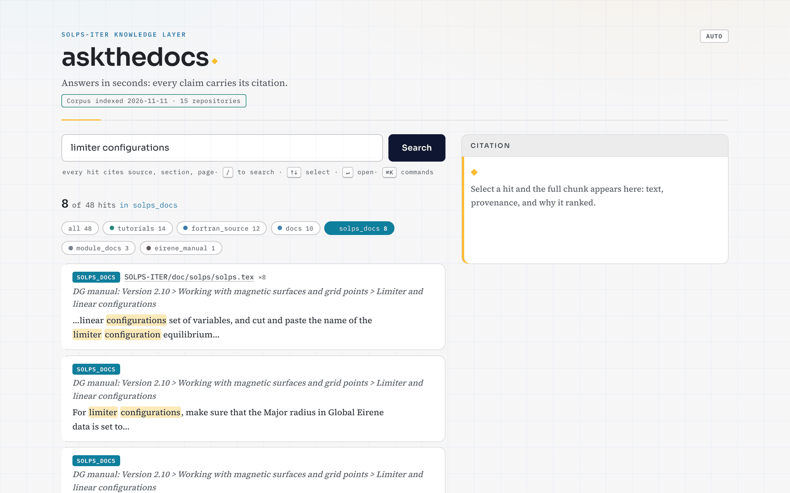

### How results rank

- Plain terms match as an implicit AND. Singular and plural match each other automatically.
- Documents containing your words as one adjacent phrase rank first. They carry a visible phrase marker.
- A query that equals a switch name or a procedure name ranks that entry first.
- Inside each tier, relevance decides.

Quoted phrases search for the exact sequence. Power users may type raw FTS5 query syntax. A query that parses as valid FTS5 takes that meaning, including column filters. Anything unparseable falls back to plain-term search instead of failing.

### Read and cite

Click a hit. The passage pane opens with the full text and its provenance: source, section, and page. Query terms are marked inside the passage, with a navigator to walk the matches.

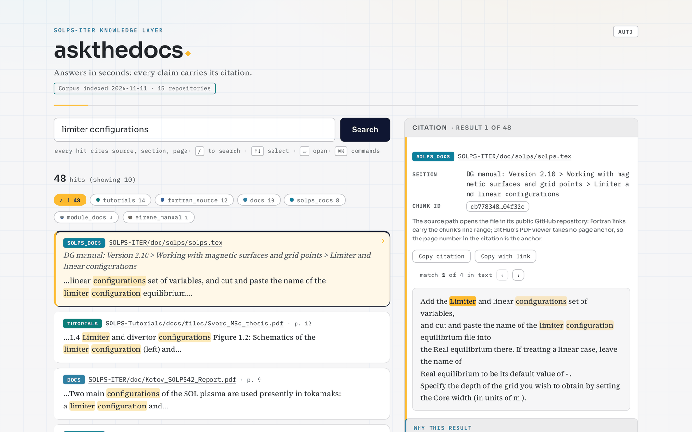

The pane's copy buttons put three things on your clipboard: a full citation line, a restoring deep link, or the bare chunk id. The chunk id is the deep link. Every hit, on every face, carries a 40-character id naming exactly one passage. Find a result anywhere, then fetch it by id alone, with no re-search. Ids are stable. They are hashes of provenance and survive corpus rebuilds, so a citation stays fetchable.

## 3. Ask an assistant

askthedocs speaks the Model Context Protocol (MCP). Two tools: `search_docs` (corpus search with citations; manual and Fortran code rank together, so an answer can cite the documentation AND the implementing procedure) and `get_chunk` (the full passage behind a hit, before you quote it). The server introduces itself at session start with a short usage card. The same text is served on demand as the `how_to_search` prompt in clients that surface prompts.

```sh
.venv/bin/askthedocs-mcp
```

The standard wiring needs no environment at all. The per-user index and the recorded corpus root resolve from any directory, and a moved index resolves through the location setup recorded. That is what a client-launched server needs: no terminal directory to lean on. The variable `ASKTHEDOCS_HOME` remains the override: set it in the shell that launches the client, or add an `"env"` block carrying it beside the command in the JSON entries below, when you want the server to see a different home than the recorded one.

One-line registration, user scope, stdio:

```sh
<your-client> mcp add --scope user askthedocs \
  -- /full/path/to/venv/bin/askthedocs-mcp
```

**Claude Code**, user scope, from any directory:

```sh
claude mcp add --scope user askthedocs \
  -- /full/path/to/venv/bin/askthedocs-mcp
```

Run `claude mcp list` to confirm the registration.

The same entry as JSON, an `mcpServers` block in the client's user config, or a project-shared `.mcp.json` at the repo root:

```json
"askthedocs": {
  "type": "stdio",
  "command": "/full/path/to/venv/bin/askthedocs-mcp"
}
```

OpenCode, in `opencode.json` (project) or `~/.config/opencode/opencode.json`:

```json
{
  "mcp": {
    "askthedocs": {
      "type": "local",
      "command": ["/full/path/to/venv/bin/askthedocs-mcp"],
      "enabled": true
    }
  }
}
```

Wire it once. Every session after starts with the usage card and both tools live.

## 4. Work from the terminal

```sh
.venv/bin/askthedocs search "limiter configurations"   # ranked hits, phrase-tier marked
.venv/bin/askthedocs search b2mndr_stim                # exact switch name ranks first
.venv/bin/askthedocs show <chunk_id>                   # full passage + provenance
.venv/bin/askthedocs status                            # corpus drifted since the build?
```

Every read verb also takes `--home PATH`, the same redirect as `setup` (see "Where the index lands"); with `ASKTHEDOCS_HOME` exported, no flag is needed.

The query syntax is the one from "How results rank": plain terms, quoted phrases, raw FTS5 for power users, and a plain fallback for the unparseable.

The deep link works from the terminal too. Worked example:

```sh
.venv/bin/askthedocs search "feedback schemes"
#   hit: SOLPS-Tutorials/docs/feature_blog/Gas_puffing_and_pumping.md,
#        section 'Density feedback schemes'
#        chunk ec9ff6572b5dc079bee027db8e9a13311eee061e
.venv/bin/askthedocs show ec9ff6572b5dc079bee027db8e9a13311eee061e
#   the exact passage, verbatim, with its provenance
```

One paste, one call. That is the intended way to hand a citation to an assistant and have it read the source without re-discovering it.

## 5. Know what is indexed

The index is built from what your clone carries. Over the full set (the SOLPS-ITER clone with its submodules, plus SOLPS-GUI and SOLPS-Tutorials beside it), it holds:

- the SOLPS-ITER manuals (TeX) and text-rich PDFs
- the EIRENE manual and its atomic and molecular databases (AMJUEL, HYDHEL, H2VIBR, and the other AMdata books)
- the GUI's reST documentation
- the DivGeo HTML manual
- the dated doc/LOG changelog (since 2002)
- the tutorials and course material
- the **b2mn.dat switch inventory**, synthesized from the B2.5 source census and the documented defaults
- the **B2.5 + EIRENE Fortran source as procedure units**

Main programs are deliberately out. They are orchestration over procedures that are all indexed, and their identifiers are covered elsewhere in the corpus. An absent optional repository is named at build time and adds nothing. Your counts match your clone.

### List the corpus before you index it

`askthedocs corpus` walks the same repositories setup would and writes the listing to a JSON file, with the per-repository counts and how each file reads (text, PDF, code). Use it to see what a build would take before running one:

```sh
$ askthedocs corpus
wrote corpus.json: 2423 sources
  SOLPS-GUI: 130
  SOLPS-ITER: 291
  ...
```

The same rule as setup applies here. The SOLPS-ITER checkout with its submodules is required; a missing or never-initialized required leg refuses and names its remedy. SOLPS-GUI and SOLPS-Tutorials are optional: an absent one is named (`optional: ... not required`) and the listing continues without it.

The index self-describes. The build manifest beside it records each repository's pinned commit. `askthedocs status` re-hashes the corpus and reports current or drifted:

```sh
$ askthedocs status
index built from corpus state 8e0f28fd: 2423 input sources (300 corpus, 2121 fortran, 2 switches)
current corpus state 8e0f28fd: 2423 input sources (300 corpus, 2121 fortran, 2 switches)
legs:
  SOLPS-GUI   current
  SOLPS-ITER  current
  ...one line per repository leg...
no drift: 0 new, 0 changed, 0 removed; index current
```

The web version answers the same question. The index status button sits under the wordmark:

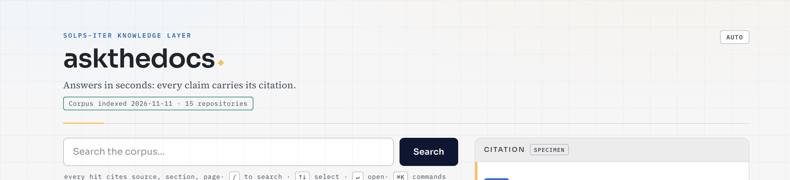

Click it and the same information opens as a modal, per module, with links.

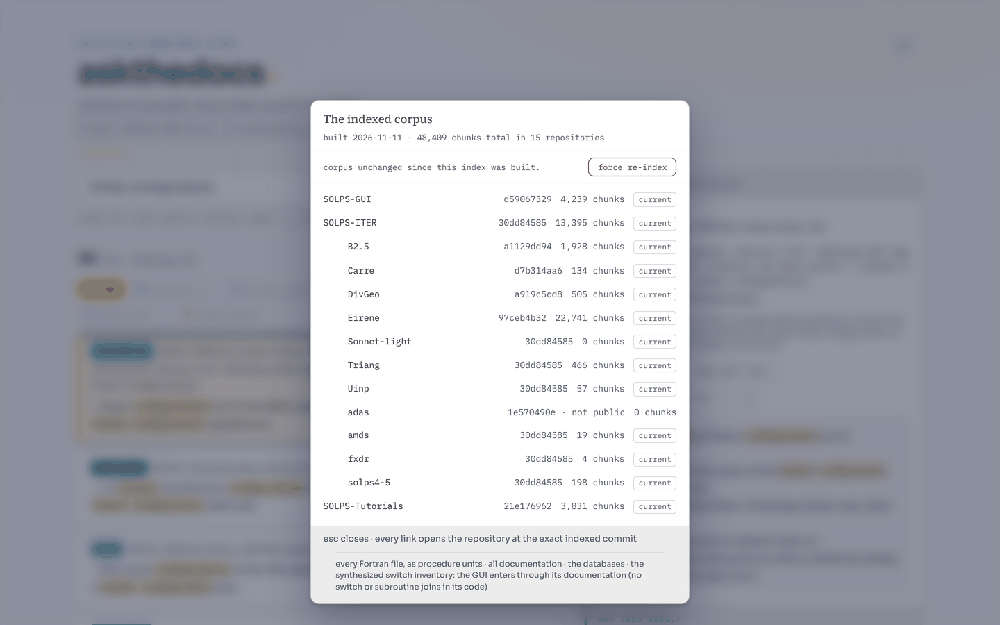

## 6. Keep the index fresh

### The freshness check

Both `setup` re-runs and `askthedocs status` run the same check. It reads the local disk only. It never queries a remote repository.

Freshness is reported per repository leg:

- **current:** on disk, and it matches the index.
- **drifted:** on disk, and it differs. The file-level evidence is printed: new, changed, removed.
- **carried:** not on disk. Served verbatim from the index, at the pinned commit the row shows.

Under a leg that IS on disk, the disk is the truth. Deletions propagate: they show as drift first, never vanish silently. A leg that vanished since the last build keeps its pinned extraction in the rebuilt store.

### From the web

The index status button reports the index's freshness: a background check runs after every page load, and once per 24 hours in a tab that stays open. It is the web face of `askthedocs status`. The border carries the answer: green current, red shifted or after a failed rebuild, yellow when the corpus cannot be found. While a rebuild runs, the edge is a steady accent color and the elapsed time ticks in the button's text. Every non-green state names itself in the button's text. Clicking it opens the modal with the details.

### The index status button, and what to do

**Green, current.** Nothing to do. The index matches the corpus. Click the button any time to re-check.


**Red, shifted or failed.** Click it for the evidence: which legs drifted, what changed. Rebuild from the confirmation. A failed rebuild names its document; fix or remove it, then rebuild again.

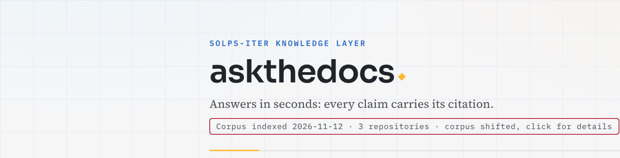

**Yellow, corpus not found.** The service cannot see the corpus. Search keeps answering from the index. Re-run `setup` from your clone to re-record the root.

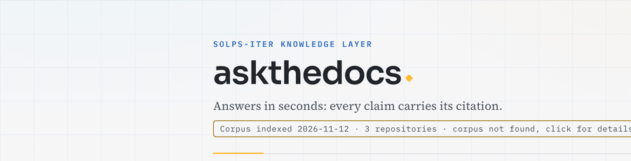

**Blue, indexing.** A rebuild is running. The elapsed time ticks in the button's text. Search keeps answering while it runs. Close the window freely: the job runs on. Click the button to watch again.

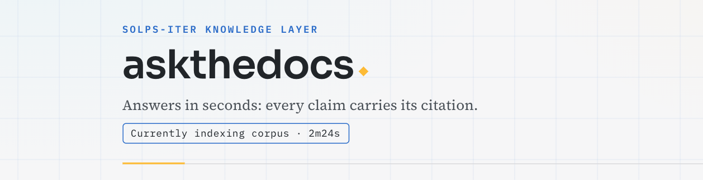

The modal re-checks freshness on every open.

The rebuild sits behind an evidence-carrying confirmation. It states the drift counts. It names the carried legs when any are carried. It quotes the expected cost from the last rebuild when one exists.

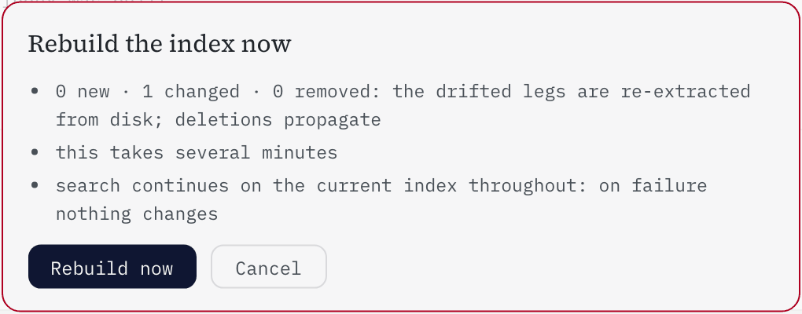

A fresh index can be rebuilt too. Force re-index sits behind its own confirmation stating that nothing changed.

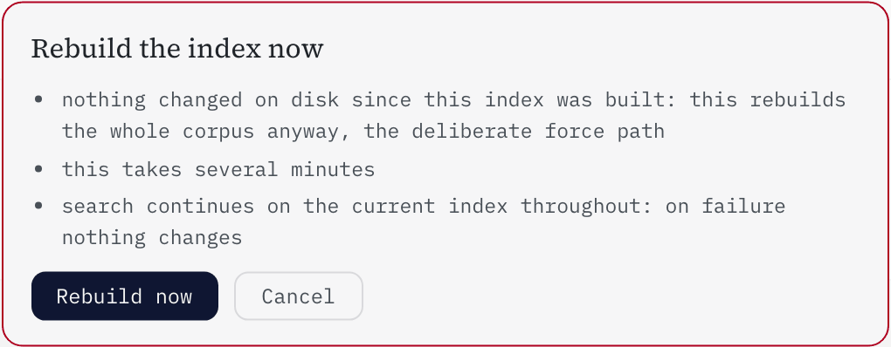

The confirmed rebuild runs in a progress window that replays the exact lines the CLI setup verb shows. Closing it never stops the job. Search keeps answering from the current index throughout. The rebuild goes to a temporary store and swaps in only on success.

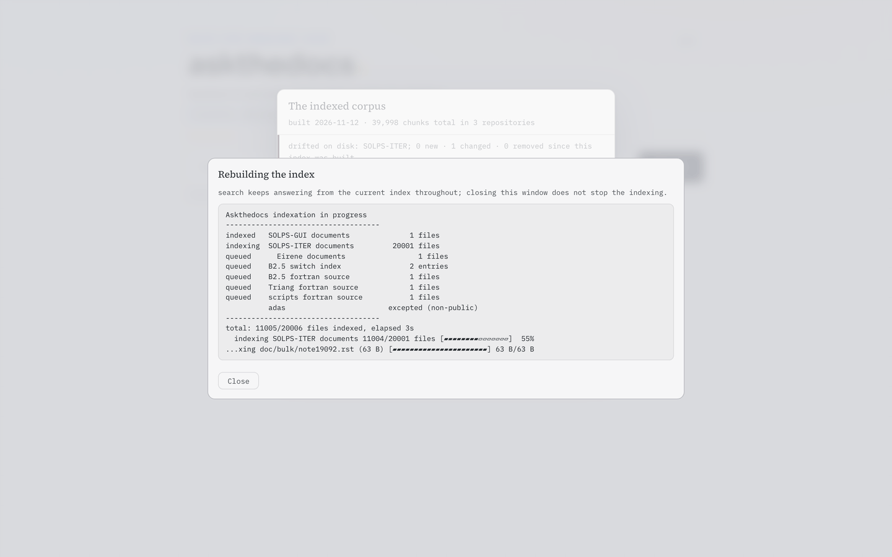

When it lands, the modal says so, with the duration (the full corpus takes at most 6 minutes):

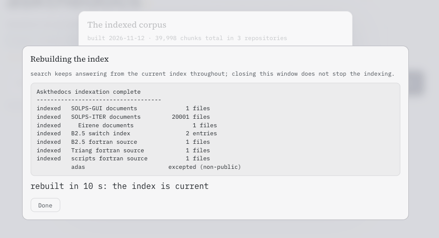

## 7. Under the hood

### Determinism

The chunk store is byte-reproducible: the same corpus state always rebuilds to a byte-identical database. The web client is a built-once certified artifact. `web/BUILD-CERT.txt` records its tree digest and the exact toolchain. Rebuilding the client yourself (optional) requires Node 18 or newer with the committed lockfile. Run `npm ci && npm run build:api` in `web/`, after clearing `web/.svelte-kit` and `web/node_modules/.vite`. Your build may differ in bytes from the certified one. The digest tells them apart.

### Performance

The search path carries a measured budget: `/search` p95 at or under 50 ms, localhost, warm, steady-state. That is not a cold-start claim. Off localhost or under load, latencies stretch with the network and the machine. The budget is the local reference point, not a warranty for remote deployments.

### Deployment note

The service is deliberately local and unauthenticated. Its only write-capable endpoint is the rebuild. Do not expose it beyond your machine.

### License

Maintained by Alfonso Sacco.

EUPL-1.1, Copyright 2026 Alfonso Sacco; see `LICENSE.md`. The web client bundles OFL-licensed fonts and MIT-licensed Svelte runtime code. Their notices travel in `web/THIRD-PARTY-NOTICES.md`. Deep format documentation (chunk schemas, ranking tiers, recovery card rules) is available on request.
