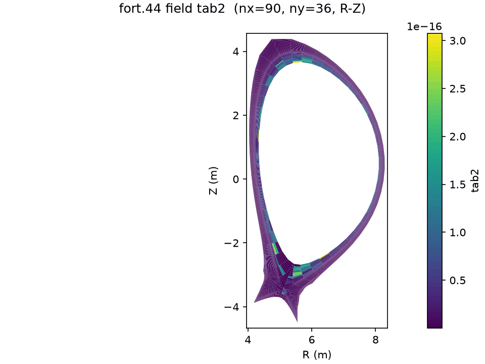
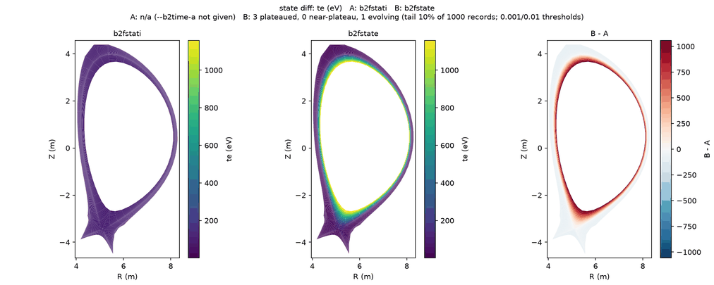
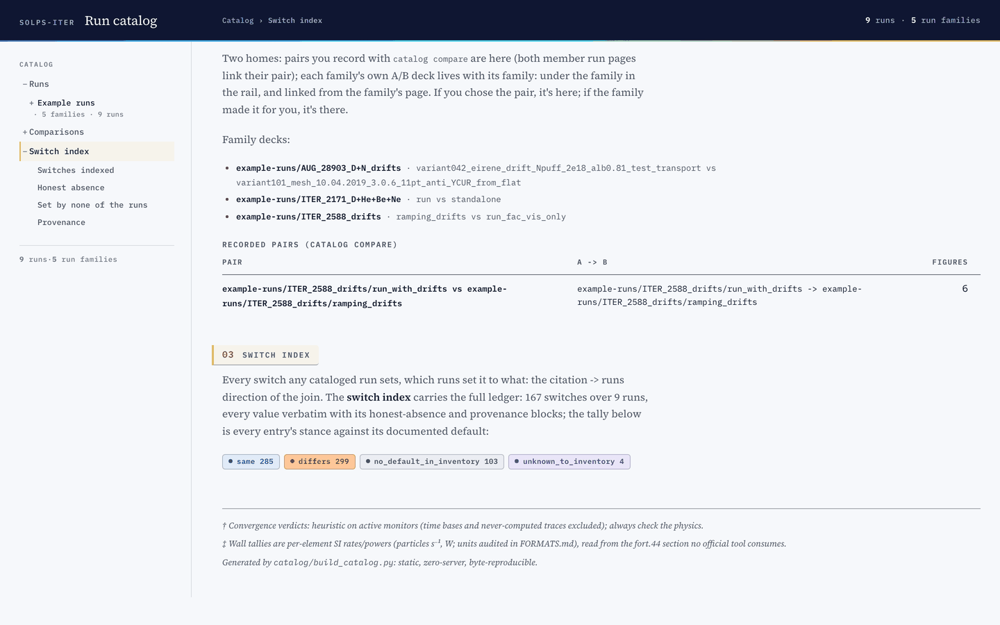
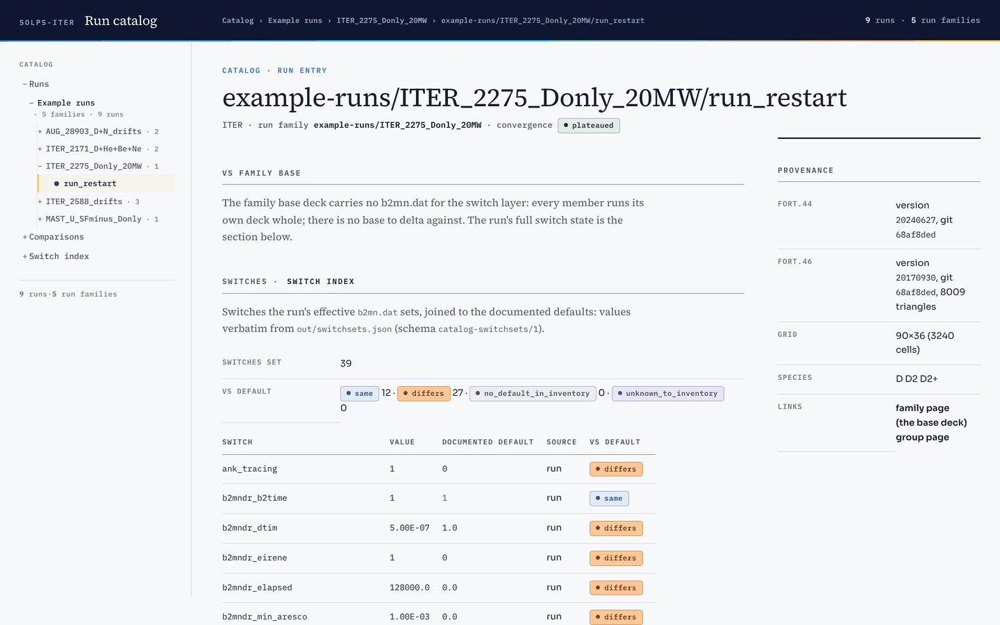

# SOLPS-Reader: read the five families, catalog your runs

SOLPS-Reader reads five families of SOLPS-ITER output files, natively from the bytes, at any path. Your own runs read the same way, verified value by value against real ITER data. The run catalog is the second tool in this package: a machine-verifiable record over the public example runs and your own, rendered as a static site. One install ships both.

The reader speaks through two doors: a CLI and MCP tools. The same readers sit behind both. The run catalog is its own thing: not a view of the readers, but a record built from runs. You can also use it for your own runs and it builds the same pages; the recipe is in the manual.

## Quick start

Python >= 3.10. The prerequisite is the repository this folder lives in: a SOLPS-ITER clone with its submodules initialized (`adas` excepted; it is pinned non-public). From the clone root:

```sh
python3 -m venv .venv
.venv/bin/pip install tools/solps-reader
.venv/bin/solps-reader setup            # verifies the checkout, 5 seconds
```

`setup` verifies the checkout and prints where it found it. A missing or half-initialized checkout is refused loudly, the remedy named in the message.

**Windows.** Every command in this README applies with the venv's Scripts directory in place of bin: `.venv\Scripts\solps-reader` wherever you read `.venv/bin/solps-reader` (`py -3 -m venv .venv` creates the venv). That one translation rule covers them all.

### If it refuses

Every refusal is loud and names its own fix. The three you might meet on day one:

- **The checkout is missing or half-initialized:** `setup` and every analysis command refuse, the missing submodules named in the message.
- **A grid or species mismatch in a state diff:** refused with exit 2, one clean line, never a traceback.
- **An MCP call without its path:** answered by a loud named error carrying an example call, so the wrong invocation explains itself.

## Ways into the reader

**Terminal.** Each family summarizes in one command, shown here on the public ITER_2275 example run:

```sh
R=/path/to/unpacked/ITER_2275_Donly_20MW

.venv/bin/solps-reader ft44 summary $R/run_restart/fort.44
.venv/bin/solps-reader state summary $R/run_restart/b2fstate \
    --check-grid $R/baserun/b2fgmtry
.venv/bin/solps-reader plasma summary $R/run_restart/b2fplasma
```

Errors are one clean line, never a traceback. Exit 2 means an unreadable file or a usage error. The same run's files also plot and compare, one command per picture:

```sh
.venv/bin/solps-reader ft44 plot $R/run_restart/fort.44 --field tab2 \
    --geometry $R/baserun/b2fgmtry -o field-map.png
.venv/bin/solps-reader state diff $R/baserun/b2fstati $R/run_restart/b2fstate \
    --geometry $R/baserun/b2fgmtry --b2time-b $R/run_restart/b2time.nc -o deck
```

The first command wrote the map below. The second wrote the deck, whose te figure follows.





**Assistants.** SOLPS-Reader speaks MCP: fourteen read-only tools for run analysis. Run inventories, field detail, convergence verdicts, plasma digests, changelog search, catalog summaries. The standard wiring needs no environment. One-line registration, user scope, stdio:

```sh
<your-client> mcp add --scope user solps-reader \
  -- /full/path/to/venv/bin/solps-mcp
```

Every tool takes its path explicitly; the server never assumes a location. The full tool inventory and the per-call rules are in the manual.

## The run catalog

The second tool, answering a different question: not "what is in this file" but "what ran, and what did it set". For each cataloged run it records which exact code commit produced it, whether it actually converged, its wall and target power loads, and every switch its effective input deck sets.



Open `tools/solps-reader/catalog/out/site/index.html` in any browser: the shipped reference set, static HTML, no server, no network, usable with scripts off. Your own runs build the same pages, from as many folders as you work with:

```sh
# tree-dependent verbs: run from the package directory
cd tools/solps-reader
../../.venv/bin/solps-reader catalog add /path/to/runs
../../.venv/bin/solps-reader catalog build
```

Every value on every page renders from a JSON manifest with an MD5 inventory of its inputs. A gate proves the whole site rebuilds byte-identically.



**The maintainer contract.** The shipped catalog is a certified snapshot of the upstream example runs. When a new example run is published, or a SOLPS-ITER release changes the documented switches, the maintainer fetches the new release, runs the one build command with `--in-tree` (the rebuild that reproduces the shipped bytes for the gate), passes the gate, bumps the version, and pushes; upstream's release tasks carry the notification line.

## What it can do

**Five families, read natively.** One reader per family, each format taken from the code's own writers:

| Files | What they hold | Module |
|-------|----------------|--------|
| `fort.44`, `fort.46` | EIRENE source terms and wall tallies (ASCII) | `solps_reader.ft44`, `solps_reader.ft46` |
| `b2*.nc` | solver histories (NetCDF-3) | `solps_reader.nc` |
| `b2fstate`, `b2fgmtry` | plasma state, geometry (cf-ASCII) | `solps_reader.state`, `solps_reader.gmtry` |
| `b2fplasma`, `b2fplasmf` | the full solution (binary or ASCII twin) | `solps_reader.plasma` |

- The package is read-only, forever: it never writes or modifies SOLPS output files.
- It needs only numpy and matplotlib: no netCDF4, no scipy, no MATLAB.
- Not bound to the examples: parsing goes by format and version, never by known file. Use it on your own runs: point any command at any path. The example layout matters only to the catalog verbs.
- The byte-level goldens are pinned to the public example runs.

Every other file kind a run folder can carry is accounted for, each with its fate, in `catalog/COVERAGE.md`.

**Read, export, plot, compare.**

- fort.44 and fort.46: a per-field statistics table, one field exported to NumPy or CSV, fort.44 fields plotted on the index grid or in real R-Z geometry.
- NetCDF histories: dimensions and per-variable tables, one variable dumped, the solver's convergence traces plotted.
- b2fstate: the full summary with an optional cross-check against the geometry file (interior and guard-cell conventions handled, never mixed), two same-grid states diffed into an A/B deck, a grid or species mismatch refused, never guessed.
- b2fplasma and its ASCII twin, detected from the bytes: the summary with the quasineutrality check, any single record inspected, every record exported at once, the version ladder from unstamped `00.000.000` through `03.000.010`.
- Any run directory, over MCP: which files exist and the run's identity (grid, species, code version), read from the headers.

**The run catalog.**

- For each public example run: which exact code commit produced it, whether it converged, and its wall and target power loads.
- Every switch its effective input deck sets, joined against the documented defaults.
- Your own runs catalog the same way, from as many folders as you work with; `catalog compare` decks any two runs against each other.
- Every page renders from an MD5-inventoried manifest; the gate proves the site rebuilds byte-identically.

Every point above is documented task by task, with screenshots, in the manual.

## The manual

The deep guide is **solps-reader-Manual.md**, beside this file. Every file family in byte-level detail, the full CLI table, the catalog in depth.

## License

Maintained by Alfonso Sacco.

EUPL-1.1, Copyright 2026 Alfonso Sacco; see `LICENSE.md`. The catalog site bundles OFL-licensed fonts; their notices travel in `catalog/fonts/`.
