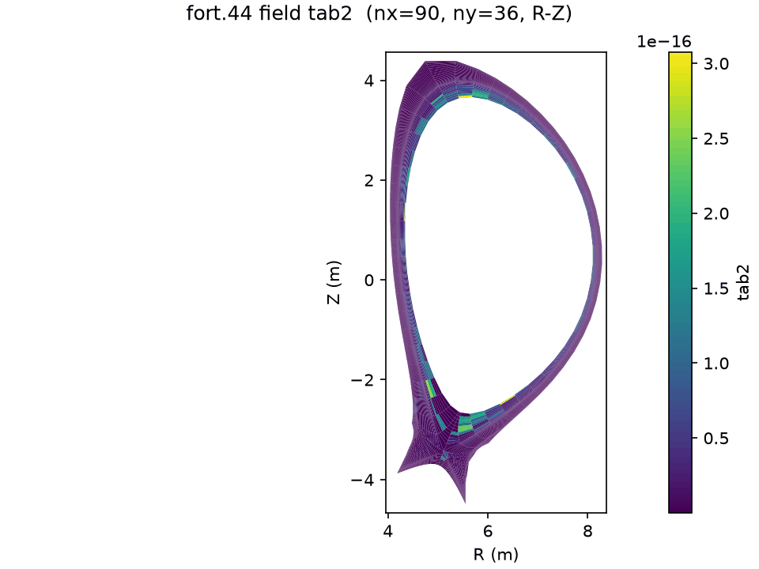
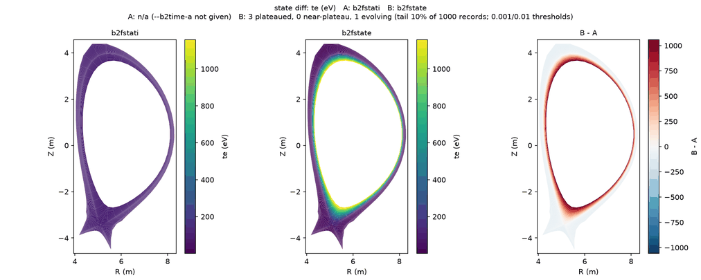
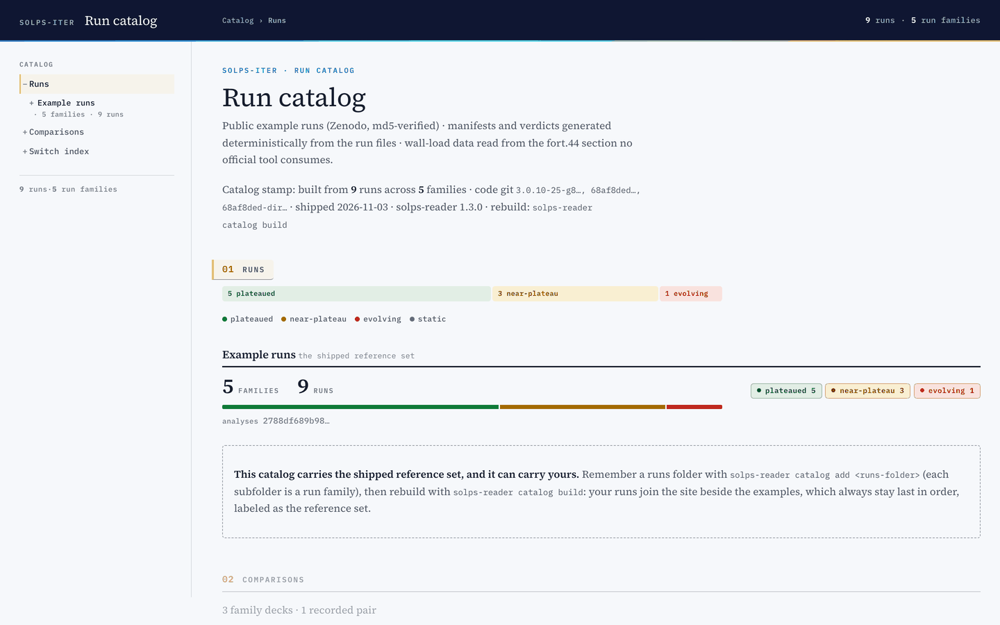
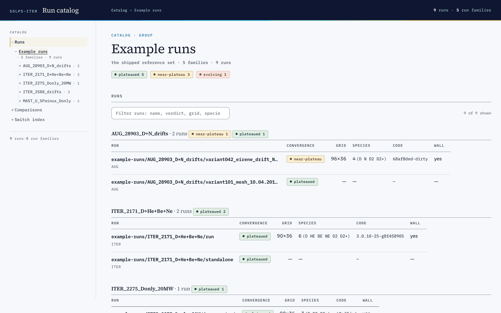
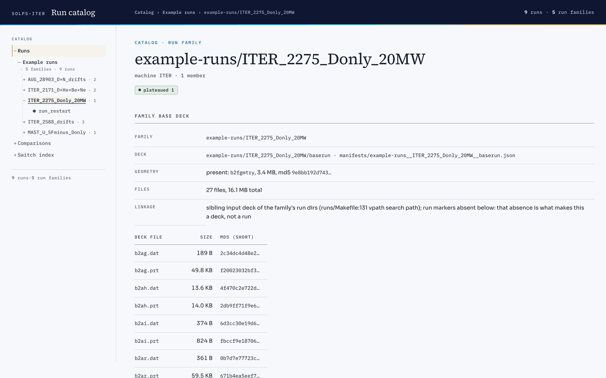
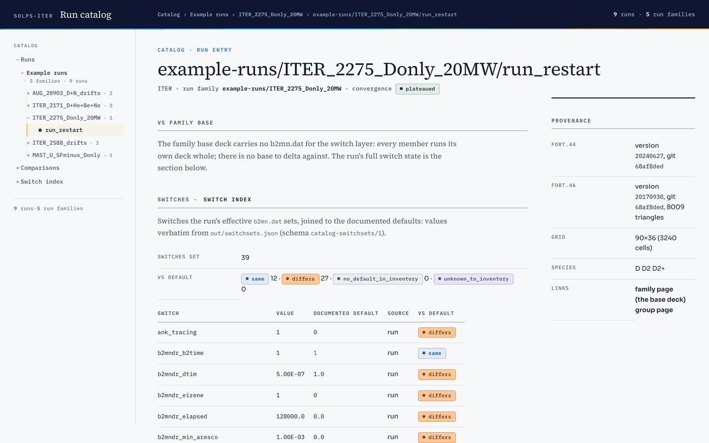
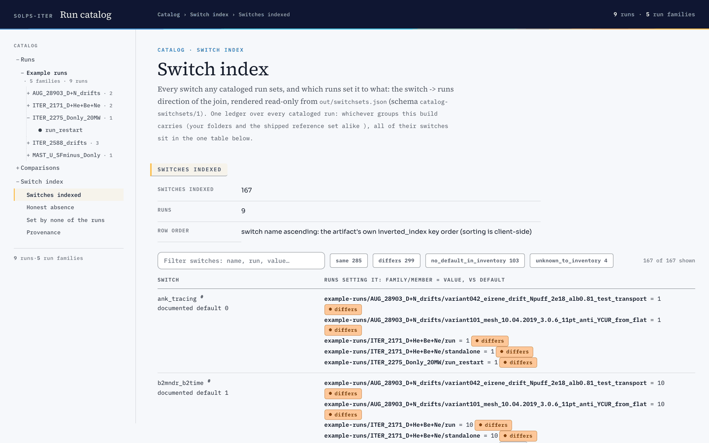
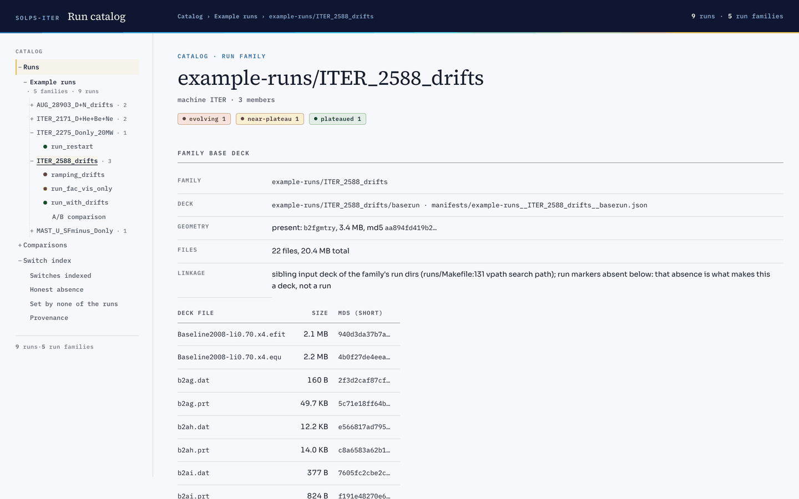
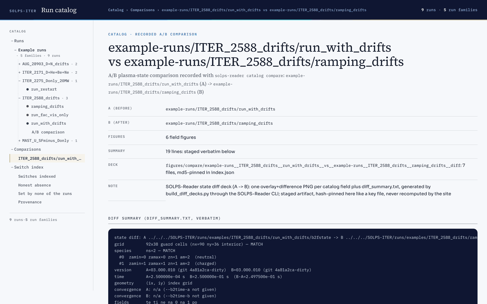

# The SOLPS-Reader manual

This is the deep guide. The quick start lives in the README beside this file.

One package, two tools. **SOLPS-Reader** reads five families of SOLPS-ITER output files, natively from the bytes, at any path. Your own runs read the same way, verified value by value against real ITER data. It needs only numpy and matplotlib: no netCDF4, no scipy, no MATLAB.

The **run catalog** is the second tool: a machine-verifiable provenance-and-quality record over the public example runs and your own, browsable as a static site that opens with zero prerequisites.

## Contents

1. [Set it up](#1-set-it-up)

**Part one: SOLPS-Reader, read the five families**

2. [Quickstart, real ITER_2275 data](#2-quickstart-real-iter_2275-data)
3. [Grid conventions](#3-grid-conventions-read-this-before-comparing-files)
4. [The b2fplasma family](#4-the-b2fplasma-family-the-full-solution)
5. [CLI reference](#5-cli-reference)
6. [Python API](#6-python-api)
7. [The MCP server](#7-the-mcp-server)

**Part two: the run catalog**

8. [Browse the catalog](#8-browse-the-catalog)
9. [Catalog your own runs](#9-catalog-your-own-runs)
10. [The catalog in depth](#10-the-catalog-in-depth)
11. [Documentation](#11-documentation)
12. [License](#12-license)

## 1. Set it up

### What you receive

One package: the readers (the CLI, the fourteen-tool MCP server), and the run catalog. The catalog's compiled pages ship in this tree (`tools/solps-reader/catalog/out/site/index.html`): static HTML with inline SVG and self-hosted fonts, no server, no network requests, fully usable offline and with scripts off. The run data behind them does not ship: the examples are located automatically on your machine (the rules sit in "The catalog in depth"), and one more command turns your own runs into the same pages.

### Prerequisites

Python 3.10 or newer (developed and frozen on 3.14 / numpy 2.5 / matplotlib 3.11). The repository this folder lives in: a clone of SOLPS-ITER with its submodules initialized. The `adas` submodule is excepted. It is pinned non-public, and nobody can initialize it. Everything else installs automatically: numpy, matplotlib, the MCP runtime.

### The three commands

From the clone root:

```bash
python3 -m venv .venv
.venv/bin/pip install tools/solps-reader
.venv/bin/solps-reader setup
```

`setup` verifies the SOLPS-ITER checkout (the clone and its submodules complete) and prints where it found it. The same gate fires on the CLI's analysis commands and at the MCP server's start. A missing or half-initialized checkout is refused loudly, the remedy named in the message.

**Windows.** Every command in this manual applies with the venv's Scripts directory in place of bin: `.venv\Scripts\solps-reader` wherever you read `.venv/bin/solps-reader` (`py -3 -m venv .venv` creates the venv). That one translation rule covers them all.

## Part one: SOLPS-Reader, read the five families

The five families, and the module that reads each:

| Family | Files | Format | Module |
|--------|-------|--------|--------|
| `ft44` | `fort.44` | ASCII: EIRENE → B2.5 source terms | `solps_reader.ft44` |
| `ft46` | `fort.46` | ASCII: EIRENE triangle-mesh tallies | `solps_reader.ft46` |
| `nc` | `b2time.nc`, `b2batch.nc`, any NetCDF-3 sibling | NetCDF-3 classic (binary) | `solps_reader.nc` |
| `state` | `b2fstate` / `b2fstati` (+ `b2fgmtry` geometry) | cf-ASCII (not XDR) | `solps_reader.state`, `solps_reader.gmtry` |
| `plasma` | `b2fplasma` / `b2fplasmf` | binary Fortran records, or the formatted twin (auto-detected) | `solps_reader.plasma` |

The reader is the first tool: it parses run output files, at any path, on demand. This section will cover: a real-data quickstart, the conventions you need before comparing files, the deepest family, then the three references (CLI, Python, MCP).

Every parsing rule is taken from the MATLAB reference readers in `SOLPS-ITER/scripts/MatlabPostProcessing/IO/` and cross-checked against the Fortran writers: the `b2fplasma` family from the Fortran reader side itself (the `b2uf`/`b2fu` converter pair and the modules behind it; no MATLAB reader exists for it). All readers are verified against real ITER divertor data (case `ITER_2275`, D-only, 20 MW) with byte-level golden values.

SOLPS-Reader is **read-only, forever**: it never writes or modifies SOLPS output files.

### 2. Quickstart (real ITER_2275 data)

```bash
R=/path/to/unpacked/ITER_2275_Donly_20MW   # any unpacked SOLPS-ITER run tree
PY=.venv/bin/solps-reader

# fort.44: header, species (D, D2, D2+), 182-field statistics table
$PY ft44 summary $R/run_restart/fort.44

# export one field for other tools; plot a quick-look map
$PY ft44 export $R/run_restart/fort.44 --field dab2 -o dab2.npz
$PY ft44 plot    $R/run_restart/fort.44 --field tab2 -o tab2.png \
                --geometry $R/baserun/b2fgmtry    # R-Z field map (optional)

# fort.46: triangle-mesh tallies (8009 triangles, 20 fields)
$PY ft46 summary $R/run_restart/fort.46
$PY ft46 export  $R/run_restart/fort.46 --field pdena -o pdena.npz

# NetCDF-3: solver histories
$PY nc summary $R/run_restart/b2time.nc
$PY nc dump    $R/run_restart/b2time.nc --var timesa -o timesa.npz
$PY nc plot    $R/run_restart/b2time.nc -o convergence.png

# b2fstate: end-of-run plasma state, checked against the geometry file
$PY state summary $R/run_restart/b2fstate
$PY state summary $R/run_restart/b2fstate --check-grid $R/baserun/b2fgmtry

# compare two same-grid states: the A/B deck (restart pair shown)
$PY state diff $R/baserun/b2fstati $R/run_restart/b2fstate -o deck \
                --geometry $R/baserun/b2fgmtry --b2time-b $R/run_restart/b2time.nc

# b2fplasma: the FULL solution (~190 arrays), binary read natively;
# b2fplasmf (the ASCII twin) is auto-detected from the bytes
$PY plasma summary $R/run_restart/b2fplasma
$PY plasma field   $R/run_restart/b2fplasma csigin
$PY plasma export  $R/run_restart/b2fplasma -o plasma.npz
```

The reference SOLPS-ITER tree is read-only input; never modify anything under it.

Two of those commands, as pictures. The field map:
```bash
    $PY ft44 plot $R/run_restart/fort.44 --field tab2 -o tab2.png --geometry $R/baserun/b2fgmtry
```


The A/B deck:
```bash
    $PY state diff $R/baserun/b2fstati $R/run_restart/b2fstate -o deck --geometry $R/baserun/b2fgmtry --b2time-b $R/run_restart/b2time.nc
```


### 3. Grid conventions: read this before comparing files

- `fort.44` / `fort.46` report the **interior** grid: nx=90 × ny=36 (fort.46: 8009 triangles).
- NetCDF (`b2*.nc`), `b2fstate`, `b2fgmtry` and `b2fplasma`/ `b2fplasmf` carry **guard cells**: 92 × 38 = (90+2) × (36+2).

Both are correct physics-code behavior; never force them equal. The interior slice of a 92 × 38 array is `[2:nx+2, 2:ny+2]` (index = ix+2, iy+2). `state summary --check-grid` automates the cross-file check.

Units: `b2fstate` and `b2fplasma` store `te`/`ti` in **joules** (multiply by 6.2415e18 for eV); fort.46 values are raw EIRENE units (the MATLAB reader's SI factors are *not* applied).

### 4. The b2fplasma family (the full solution)

`b2fstate` is the **checkpoint**; `b2fplasma` is the **full solution**: every profile, source, transport coefficient and diagnostic array of the final iteration (~190 records on a current run: densities, temperatures, flows, all flux components, the anomalous-transport coefficients, the neutral-source scaling). Its ASCII twin `b2fplasmf` carries the identical records in formatted form. Both are read natively; no converter run, no intermediate files; which encoding a path holds is detected from the bytes, not the name.

Three things to know:

- **Grid dims come from the sibling `b2fstate`.** The file itself does not carry nx/ny/ns; the code's own converter takes them from `b2fstate` the same way. Any run directory has one beside its `b2fplasma`; `--b2fstate PATH` / `--dims NX,NY,NS` override. A wrong triple can never pass silently: every record's declared element count is checked against it while opening.
- **Opening is efficient.** A 90 MB file opens in tens of milliseconds (only the record headers are walked); arrays load on first access. `export` materializes all of them into one `.npz`.
- **Every known version is handled.** Files from `00.000.000` (unstamped) through `03.000.010` parse per their own version gates, optional records included. Byte-level verification: all nine public example runs walk strictly clean, and on the `ITER_2171` runs the `na` record reads byte-identical from both `b2fplasma` and `b2fstate`; the two readers provably agree at the value level.

### 5. CLI reference

The signatures show the arguments in the order the worked examples type them; the software accepts them in any order. Every table row is a pattern; the worked example under it fills each pattern with a real value.

```bash
solps-reader ft44 summary <path/to/fort.44>
```

| Argument | Required | Meaning | In the example |
|----------|----------|---------|----------------|
| `ft44` | yes | the family: the fort.44 reader | `ft44` |
| `summary` | yes | the command: prints the header (nx, ny, version, git hash), the species labels, and the per-field table (key, size, min, max, mean) | `summary` |
| `<path/to/fort.44>` | yes | the fort.44 file to read | `run_restart/fort.44` |
```bash
# worked example: the fort.44 header, species, and field table
$ .venv/bin/solps-reader ft44 summary run_restart/fort.44
fort.44: fort.44
grid         nx=90 ny=36
version      20240627 (git 68af8ded)
species      natm=1 nmol=1 nion=1 nfla=1
  atoms      D
  molecules  D2
  ions       D2+
fields       182

name             size              min              max             mean
dab2             3240     0.000000e+00     1.389240e+20     1.975206e+18
tab2             3240     1.602177e-25     3.075588e-16     1.159293e-17
...
wldnek(0)         186    -2.284505e+05     5.384852e+05     6.884977e+03
wldnek(  1)       186    -1.057191e+05     4.211370e+05     2.509004e+03
```
---
```bash
solps-reader ft44 export <path/to/fort.44> [options]
```

| Argument | Required | Meaning | In the example |
|----------|----------|---------|----------------|
| `ft44` | yes | the family: the fort.44 reader | `ft44` |
| `export` | yes | the command: writes one field to a `.npz` (default) or `.csv` file | `export` |
| `<path/to/fort.44>` | yes | the fort.44 file to read | `run_restart/fort.44` |
| `--field KEY` | yes | the field to export; use the exact name the summary command prints | `--field dab2` |
| `-o OUTPUT` | yes | the output file; its extension picks the format | `-o dab2.npz` |
| `--format {npz,csv}` | no | the format, when you want it explicit | not used, `.npz` decides |
```bash
# worked example: export one fort.44 field to a NumPy archive
$ .venv/bin/solps-reader ft44 export run_restart/fort.44 --field dab2 -o dab2.npz
wrote dab2 shape=(90, 36) as npz -> dab2.npz
```
***
```bash
solps-reader ft44 plot <path/to/fort.44> [options]
```

| Argument | Required | Meaning | In the example |
|----------|----------|---------|----------------|
| `ft44` | yes | the family: the fort.44 reader | `ft44` |
| `plot` | yes | the command: draws a pcolormesh of one (nx, ny) field: (ix, iy) index grid, or physical R-Z with `--geometry` (per-cell quads from crx/cry corners, equal aspect, guard ring skipped) | `plot` |
| `<path/to/fort.44>` | yes | the fort.44 file to read | `run_restart/fort.44` |
| `--field KEY` | yes | the field to draw; use the exact name the summary command prints | `--field tab2` |
| `-o OUTPUT` | yes | the PNG file to write | `-o tab2.png` |
| `--geometry B2FGMTRY` | no | the b2fgmtry file: physical R-Z cell coordinates instead of the index grid | `--geometry baserun/b2fgmtry` |
```bash
# worked example: plot one fort.44 field as an R-Z map
$ .venv/bin/solps-reader ft44 plot run_restart/fort.44 --field tab2 -o tab2.png --geometry baserun/b2fgmtry
wrote tab2 pcolormesh (90x36, R-Z geometry) -> tab2.png
```
***
```bash
solps-reader ft46 summary <path/to/fort.46>
```

| Argument | Required | Meaning | In the example |
|----------|----------|---------|----------------|
| `ft46` | yes | the family: the fort.46 reader | `ft46` |
| `summary` | yes | the command: prints the header (ntri, version, git hash), the species labels, and the per-field table | `summary` |
| `<path/to/fort.46>` | yes | the fort.46 file to read | `run_restart/fort.46` |
```bash
# worked example: the fort.46 header and tally table
$ .venv/bin/solps-reader ft46 summary run_restart/fort.46
fort.46: run_restart/fort.46
mesh         ntri=8009
version      20170930 (git 68af8ded)
species      natm=1 nmol=1 nion=1
  atoms      D
  molecules  D2
  ions       D2+
fields       20

name       size              min              max             mean
pdena      8009     0.000000e+00     1.395760e+14     1.706001e+12
pdenm      8009     0.000000e+00     1.317420e+14     3.130073e+12
pdeni      8009     0.000000e+00     4.870503e+12     1.471276e+10
edena      8009     0.000000e+00     5.581936e+14     7.092269e+12
...
pvx        8009    -1.000000e+00     9.999993e-01     2.405262e-02
pvy        8009    -9.999286e-01     1.000000e+00     7.016848e-02
```
---
```bash
solps-reader ft46 export <path/to/fort.46> [options]
```

| Argument | Required | Meaning | In the example |
|----------|----------|---------|----------------|
| `ft46` | yes | the family: the fort.46 reader | `ft46` |
| `export` | yes | the command: writes one field to a `.npz` (default) or `.csv` file | `export` |
| `<path/to/fort.46>` | yes | the fort.46 file to read | `run_restart/fort.46` |
| `--field KEY` | yes | the field to export; use the exact name the summary command prints | `--field pdena` |
| `-o OUTPUT` | yes | the output file; its extension picks the format | `-o pdena.npz` |
| `--format {npz,csv}` | no | the format, when you want it explicit | not used, `.npz` decides |
```bash
# worked example: export one fort.46 field to a NumPy archive
$ .venv/bin/solps-reader ft46 export run_restart/fort.46 --field pdena -o pdena.npz
wrote pdena shape=(8009, 1) as npz -> pdena.npz
```
***
```bash
solps-reader nc summary <path/to/b2*.nc>
```

| Argument | Required | Meaning | In the example |
|----------|----------|---------|----------------|
| `nc` | yes | the family: the NetCDF history reader | `nc` |
| `summary` | yes | the command: prints the dimensions (unlimited dims show record count) and the per-variable table (name, dims, dtype, min/max) | `summary` |
| `<path/to/b2*.nc>` | yes | the history file to read, any `b2*.nc` | `run_restart/b2time.nc` |
```bash
# worked example: the b2time.nc dimensions and variables
$ .venv/bin/solps-reader nc summary run_restart/b2time.nc
b2time.nc: run_restart/b2time.nc
format       NetCDF-3 classic
dimensions   11
  nx    92
  ny    38
  nybl  38
  nybr  38
  nyi   38
  nya   38
  nc    1
  ns    2
  natm  1
  nmol  1
  time  unlimited (1000 records)
variables    187

name      dims              dtype              min              max
ntstep    ()                >f8       1.000000e+03     1.000000e+03
jxi       ()                >f8       3.200000e+01     3.200000e+01
jxa       ()                >f8       5.500000e+01     5.500000e+01
jsep      ()                >f8       1.100000e+01     1.100000e+01
timesa    (time)            >f8       5.000000e-07     5.000000e-04
...
tab3dr    (time,natm,nybr)  >f8       1.602177e-25     2.551070e-16
dmb3dr    (time,nmol,nybr)  >f8       0.000000e+00     7.596193e+19
tmb3dr    (time,nmol,nybr)  >f8       1.602177e-25     1.582983e-17
```
---
```bash
solps-reader nc dump <path/to/b2*.nc> [options]
```

| Argument | Required | Meaning | In the example |
|----------|----------|---------|----------------|
| `nc` | yes | the family: the NetCDF history reader | `nc` |
| `dump` | yes | the command: writes one variable to a `.npz` under its own name | `dump` |
| `<path/to/b2*.nc>` | yes | the history file to read, any `b2*.nc` | `run_restart/b2time.nc` |
| `--var NAME` | yes | the variable to dump; use the exact name the summary command prints | `--var timesa` |
| `-o OUTPUT` | yes | the output file (npz format) | `-o timesa.npz` |
```bash
# worked example: dump one b2time.nc variable to a NumPy archive
$ .venv/bin/solps-reader nc dump run_restart/b2time.nc --var timesa -o timesa.npz
wrote timesa dims=('time',) shape=(1000,) -> timesa.npz
```
***
```bash
solps-reader nc plot <path/to/b2*.nc> [options]
```

| Argument | Required | Meaning | In the example |
|----------|----------|---------|----------------|
| `nc` | yes | the family: the NetCDF history reader | `nc` |
| `plot` | yes | the command: draws one stacked panel per 1-D record variable (the convergence traces) vs the record dimension | `plot` |
| `<path/to/b2*.nc>` | yes | the history file to read, any `b2*.nc` | `run_restart/b2time.nc` |
| `-o OUTPUT` | yes | the PNG file to write | `-o convergence.png` |
```bash
# worked example: plot the b2time.nc convergence traces
$ .venv/bin/solps-reader nc plot run_restart/b2time.nc -o convergence.png
wrote 7 traces (1000 records) vs time -> convergence.png
```
---
```bash
solps-reader state summary <path/to/b2fstate> [options]
```

| Argument | Required | Meaning | In the example |
|----------|----------|---------|----------------|
| `state` | yes | the family: the b2fstate reader | `state` |
| `summary` | yes | the command: prints the header (nx, ny, ns, version, git, label), the numeric species set, `time`, and the per-field table | `summary` |
| `<path/to/b2fstate>` | yes | the b2fstate file to read | `run_restart/b2fstate` |
| `--check-grid B2FGMTRY` | no | the b2fgmtry file: verify the grid against it, three sub-checks, PASS or FAIL | not used; the section end shows PASS and FAIL |
```bash
# worked example: the b2fstate header and field table
$ .venv/bin/solps-reader state summary run_restart/b2fstate
b2fstate: run_restart/b2fstate
grid         nx=90 ny=36 (interior) -> 92x38 guard cells
version      03.000.010 (git 4a81a2ca-dirty)
label        b2mn     B2.5 bjb99/7 SOLPS-ITER  2026-02-27  09:17 bonninx ITER#2275_(F57-20MW-D,_tau=0.5e-6,_ntime=50)
species      ns=2
  #0  zamin=0 zamax=0 zn=1 am=2  (neutral)
  #1  zamin=1 zamax=1 zn=1 am=2  (charged)
time         5.000000e-04 s
fields       48

name           size              min              max              mean
na             6992     1.000000e+04     5.962099e+20     1.170597e+19
ne             3496     2.430964e+16     5.962099e+20     2.341195e+19
ua             6992    -1.228353e+05     5.391190e+04     1.481227e+03
uadia         13984     0.000000e+00     0.000000e+00     0.000000e+00
te             3496     5.650206e-20     2.227234e-16     2.350922e-17
...
floe_noc       6992    -1.598872e+23     1.929188e+23     1.918649e+21
floi_noc       6992    -1.643752e+23     1.884487e+23     1.303454e+20
```
---
```bash
solps-reader state diff <path/to/b2fstate A> <path/to/b2fstate B> [options]
```

| Argument | Required | Meaning | In the example |
|----------|----------|---------|----------------|
| `state` | yes | the family: the b2fstate reader | `state` |
| `diff` | yes | the command: builds the A\|B\|B−A deck for two same-grid, same-species states: per-field `<key>.png` (te/ti in eV, per-species `na_k`, shared A/B color scale, symmetric diverging diff; R-Z with `--geometry`) plus `diff_summary.txt` (ranges, max\|B−A\|, max per-cell rel) plus the convergence annotation per side; refuses (exit 2) on grid or species mismatch | `diff` |
| `<path/to/b2fstate A>` | yes | the first state, run A | `baserun/b2fstati` |
| `<path/to/b2fstate B>` | yes | the second state, run B | `run_restart/b2fstate` |
| `-o OUTPUT` | yes | the deck directory to write | `-o deck` |
| `--geometry B2FGMTRY` | no | the b2fgmtry file: physical R-Z cell coordinates instead of the index grid | `--geometry baserun/b2fgmtry` |
| `--b2time-a PATH` | no | run A's b2time.nc, for the convergence annotation | not used |
| `--b2time-b PATH` | no | run B's b2time.nc, for the convergence annotation | not used |
```bash
# worked example: the A/B deck for the restart pair
$ .venv/bin/solps-reader state diff baserun/b2fstati run_restart/b2fstate -o deck --geometry baserun/b2fgmtry
state diff: A baserun/b2fstati -> B run_restart/b2fstate
grid         92x38 guard cells (nx=90 ny=36 interior): MATCH
species      ns=2: MATCH
  #0  zamin=0 zamax=0 zn=1 am=2  (neutral)
  #1  zamin=1 zamax=1 zn=1 am=2  (charged)
version      A=03.000.007 (git 3.0.7-beta-5-gb0055146)  B=03.000.010 (git 4a81a2ca-dirty)  [NOTE: versions differ; records matched by name]
time         A=0.000000e+00 s  B=5.000000e-04 s  (B-A=5.000000e-04 s)
geometry     baserun/b2fgmtry
convergence  A: n/a (--b2time-a not given)
convergence  B: n/a (--b2time-b not given)
fields       te ti ne na_0 na_1 po

name       unit            min A            max A            min B            max B         max|B-A|     max rel   (interior cells; rel over |A| >= 1% max|A|)
te           eV     1.000000e+02     1.000000e+02     6.263043e-01     1.158264e+03     1.058264e+03   1.058e+01
ti           eV     1.000000e+02     1.000000e+02     6.554931e-01     1.201550e+03     1.101550e+03   1.102e+01
ne                  1.000000e+19     1.000000e+19     2.819303e+16     5.962099e+20     5.862099e+20   5.862e+01
na_0                1.000000e+08     1.000000e+08     1.000000e+04     2.327441e+10     2.317441e+10     2.317e+02
na_1                1.000000e+19     1.000000e+19     2.819303e+16     5.962099e+20     5.862099e+20   5.862e+01
po                  3.100000e+02     3.100000e+02     1.412384e+00     9.128016e+01     3.085876e+02   9.954e-01
wrote 6 figures + diff_summary.txt -> deck
```
***
```bash
solps-reader plasma summary <path/to/b2fplasma> [options]
```

| Argument | Required | Meaning | In the example |
|----------|----------|---------|----------------|
| `plasma` | yes | the family: the b2fplasma reader, the full solution | `plasma` |
| `summary` | yes | the command: prints the header (grid + dims source, version, encoding, species, strata, record count), the quasineutrality check, core-field stats, and the seven block inventories | `summary` |
| `<path/to/b2fplasma>` | yes | the b2fplasma file to read (b2fplasmf, the ASCII twin, is auto-detected) | `run_restart/b2fplasma` |
| `--b2fstate PATH` | no | the b2fstate to take nx, ny, ns from (default: the sibling b2fstate) | not used |
| `--dims NX,NY,NS` | no | the grid dims, when no b2fstate is available | not used |
```bash
# worked example: the b2fplasma header and inventories
$ .venv/bin/solps-reader plasma summary run_restart/b2fplasma
b2fplasma: run_restart/b2fplasma
grid         nx=90 ny=36 (interior) -> 92x38 guard cells (dims from sibling b2fstate)
version      03.000.010 (git 4a81a2ca-dirty)
encoding     binary (Fortran unformatted records)
species      ns=2
strata       nstra=7
records      191 present, 3 optional absent
quasineutral ne = sum z*na: max residual 0.000e+00 (rel 0.0e+00): PASS

core fields (min / max / mean over all cells):
  na                   92x38x2     1.000000e+04    5.962099e+20    1.170597e+19
  ne                     92x38     2.430964e+16     5.962099e+20    2.341195e+19
  te                     92x38     5.650206e-20     2.227234e-16     2.350922e-17
  ti                     92x38     7.395277e-20     2.361578e-16     2.884916e-17
...
  anomalous transport (11): sig0 hce0 alf0 hci0 hcib dpa0 dna0 vsa0 vla0
                            csig_an calf_an
  neutral source scaling (3): nstra sclstra sclrtio
```
---
```bash
solps-reader plasma field <path/to/b2fplasma> RECORD [options]
```

| Argument | Required | Meaning | In the example |
|----------|----------|---------|----------------|
| `plasma` | yes | the family: the b2fplasma reader, the full solution | `plasma` |
| `field` | yes | the command: prints one record: shape, min/max/mean, first values (column-major) | `field` |
| `<path/to/b2fplasma>` | yes | the b2fplasma file to read | `run_restart/b2fplasma` |
| `RECORD` | yes | the record name, exactly as the summary inventory prints it | `csigin` |
| `--b2fstate PATH` | no | the b2fstate to take nx, ny, ns from (default: the sibling b2fstate) | not used |
| `--dims NX,NY,NS` | no | the grid dims, when no b2fstate is available | not used |
```bash
# worked example: one b2fplasma record's statistics
$ .venv/bin/solps-reader plasma field run_restart/b2fplasma csigin
csigin: shape (92x38x2x2x2)
  min / max / mean:    0.000000e+00    1.569958e-09    9.053128e-13
  first values (column-major): 0.000000e+00, 0.000000e+00, 0.000000e+00, 0.000000e+00, 0.000000e+00, 0.000000e+00, 0.000000e+00, 0.000000e+00, 0.000000e+00, 0.000000e+00, 0.000000e+00, 0.000000e+00 ...
```
***
```bash
solps-reader plasma export <path/to/b2fplasma> [options]
```

| Argument | Required | Meaning | In the example |
|----------|----------|---------|----------------|
| `plasma` | yes | the family: the b2fplasma reader, the full solution | `plasma` |
| `export` | yes | the command: writes **every** record to one `.npz` keyed by name (npz-only: species-resolved records are 3-D and up) | `export` |
| `<path/to/b2fplasma>` | yes | the b2fplasma file to read | `run_restart/b2fplasma` |
| `-o OUTPUT` | yes | the output file (npz format) | `-o plasma.npz` |
| `--b2fstate PATH` | no | the b2fstate to take nx, ny, ns from (default: the sibling b2fstate) | not used |
| `--dims NX,NY,NS` | no | the grid dims, when no b2fstate is available | not used |
```bash
# worked example: every b2fplasma record to one NumPy archive
$ .venv/bin/solps-reader plasma export run_restart/b2fplasma -o plasma.npz
wrote 191 records -> plasma.npz
```
***

`--check-grid B2FGMTRY` cross-checks the state against its geometry file: three sub-checks (interior dims, derived guard box, finite coordinates), each with its own PASS/FAIL line. A passing check, real output (exit code 0):

```bash
$ .venv/bin/solps-reader state summary run_restart/b2fstate --check-grid baserun/b2fgmtry
grid check   PASS  (b2fgmtry: baserun/b2fgmtry)
  dims        PASS  nx,ny: 90,36 = 90,36
  guard box   PASS  92x38 = 92x38
  coordinates PASS  crx,cry shaped (92,38,4), all finite
```
***
A failing check, real output: the same state checked against a different machine's geometry (exit code 1, a result, not an error):

```bash
grid check   FAIL  (b2fgmtry: ../MAST_U_SFminus_Donly/baserun/b2fgmtry)
  dims        FAIL  nx,ny: 90,36 != 117,21
  guard box   FAIL  92x38 != 119x23
  coordinates PASS  crx,cry shaped (119,23,4), all finite
```

### 6. Python API

For scripting, and for assistants driving the readers programmatically. The readers are plain functions on plain paths:

```python
import numpy as np
from solps_reader.ft44 import read_ft44
from solps_reader.ft46 import read_ft46
from solps_reader.nc import load_nc
from solps_reader.gmtry import read_b2fgmtry
from solps_reader.state import read_b2fstate

ft = read_ft44(".../run_restart/fort.44")     # or read_ft46, read_b2fstate
ft.keys()                                     # disambiguated field keys
dab2 = np.asarray(ft["dab2"].data)            # (90, 36) float64

ncf = load_nc(".../run_restart/b2time.nc")    # dims, variables, attributes
timesa = ncf["timesa"]                        # (1000,) >f8 record variable
ncf.time_traces()                             # 1-D variables vs the record dim

gm = read_b2fgmtry(".../baserun/b2fgmtry")    # 44 cf records, grid_shape (92, 38)
crx = gm["crx"]                               # (92, 38, 4) corner R coordinates

from solps_reader.plasma import read_b2fplasma
with read_b2fplasma(".../run_restart/b2fplasma") as pl:   # lazy: headers only
    te = pl["te"]                              # (92, 38) float64
    na = pl["na"]                              # (92, 38, ns)
    pl.keys()                                  # ~190 record names, file order
    pl.load_all()                              # everything, for export
# dims: sibling b2fstate by default; read_b2fplasma(p, b2fstate=...,
# dims="90,36,3") override. Context manager closes the lazy handle.
```

### 7. The MCP server

`solps-mcp` (or `python -m solps_reader.mcp`) starts a read-only MCP server with fourteen tools for AI-driven run analysis:

- **Run tools**: inventory a run directory; fort.44 field inventory and per-field detail; fort.46 summary and per-field detail; solver convergence classification from b2time.nc; plasma-state digest with quasineutrality check and optional grid cross-check; the full plasma solution (b2fplasma/b2fplasmf) as a summary plus per-record drill-down.
- **Changelog**: search the dated doc/LOG changelog and release-note titles.
- **Catalog tools**: run-catalog summaries, per-run manifests, and the switch joins (a run's effective switch table; which runs set a switch), reading the shipped catalog artifacts.

Ten of the fourteen read run files live at any path; the four catalog tools serve the catalog's built record instead. Part two tells that story.

Per-call semantics: every tool takes its run directory, file, or catalog root as an **explicit argument**; the server never assumes a location. A call without its path answers a loud named error with an example call, so a wrong invocation is always self-explaining.

The server command underneath:

```bash
.venv/bin/solps-mcp
```

The standard wiring needs no environment: the checkout gate at the server's start resolves the root `setup` recorded, from any directory.

One-line registration, user scope, stdio:

```bash
<your-client> mcp add --scope user solps-reader \
  -- /full/path/to/venv/bin/solps-mcp
```

**Claude Code**, user scope, from any directory:

```bash
claude mcp add --scope user solps-reader \
  -- /full/path/to/venv/bin/solps-mcp
```

Run `claude mcp list` to confirm the registration.

OpenCode, in `opencode.json` (project) or `~/.config/opencode/opencode.json`:

```json
{
  "mcp": {
    "solps-reader": {
      "type": "local",
      "command": ["/full/path/to/venv/bin/solps-mcp"],
      "enabled": true
    }
  }
}
```

Wire it once. Every session after starts with the fourteen tools live.

## Part two: the run catalog

The run catalog is the second tool: a record built from runs, not a parser. This section will cover: browse the catalog, catalog your own folders, then verify and rebuild.

### 8. Browse the catalog

**The catalog shows the public example runs as pages, and your own runs build the same pages, as many folders as you work with.** It is an independent, machine-verifiable record over the public SOLPS-ITER example runs (the Zenodo releases): for each cataloged run it records **which exact code commit produced it**, **whether it actually converged**, **what its wall and target power loads are**, and **which solver switches its effective input deck sets**. Cataloging your own folders is one command per folder; the next section shows the commands.

Open `catalog/out/site/index.html` in any browser (a `file://` URL works). The homepage is an inventory dashboard, and displays what each section in the folder tree menu contains.



Why trust the numbers: every value on every page renders from a JSON manifest that is itself derived from the run files by a fixed pipeline; the manifests carry an MD5 inventory of every key input file; and the rebuild gate (below) proves the whole site rebuilds **byte-identically** from the same inputs. Nothing on a page is hand-copied or re-derived. Every file a run folder can carry is accounted for on a page or ruled out with a reason: `catalog/COVERAGE.md` is that map, pinned to the corpus by the test suite (the recipe and the rebuild gate sit under "The catalog in depth"). A folder that grows an unknown kind fails the suite until the map rules on it. Nothing can look like a miss by omission.

**The site holds three sections, Runs · Comparisons · Switches:**

- **Runs** (9 today, from the example runs): when you click a run root folder you will notice that the page displays an inventory dashboard of all the runs in the folder classified by family.

  

  When you click a family, the page anchors on the base member and shows the family's shared baserun deck once; a family with two or more runs also carries its own A/B state-diff deck (the Comparisons section below tells the two homes apart).

  

  When you click a run, the dossier opens: provenance (the exact code commit, machine, grid, species), the convergence verdict with a per-monitor sparkline strip, wall and target power loads (a figure when the wall gate passed, the recorded cause verbatim otherwise), the run's effective switch table, the vs-base override delta, and the key-file inventory.

  
- **The switch index**: the citation-to-runs direction. All documented `b2mn.dat` switches; every row shows which run sets the switch to what value, joined against the documented default (same / differs / no default / unknown). The documented-but-never-set switches are listed too, with the count arithmetic stated in prose.

  
- **Comparisons, two homes**: the pairs you record with `catalog compare` (more details in section 9) sit in the top-level Comparisons section, backlinked from both member run pages and naming the code delta when the two legs rode different code commits; the A/B state-diff decks each family makes for itself (per-field comparison figures in real R-Z geometry with a shared color scale, the diff summary, and the family's shared input deck) live on the family's own page.

  

Each page carries one inline script: client-side table sorting, filtering, and search.

**Viewports.** The site is designed for desktop browsing: a window roughly 1080 px wide or wider, where the left menu sits beside the content. Narrower windows stay fully usable: the menu moves behind a hamburger button at the right end of the header band. No phone-specific layout is intended: everything is present and reachable on a small screen, but the layout does not chase it.

The MCP server (part one) serves this record too: its four catalog tools read the built artifacts over the wire.

### 9. Catalog your own runs

**Your own runs build the same pages.** `solps-reader catalog add <path>` remembers a folder, once per folder: an archive folder and a current folder, or as many as you work with. The order you add them in is the order they appear, and the example runs always follow last. Then `solps-reader catalog build` gives your runs the same dossiers, comparisons, and switch tables. `solps-reader catalog compare <run-a> <run-b>` builds an A/B comparison for any two runs, across folders included: your archive setup against its current version, for example.

**The commands, one unit each.** The captures come from one sitting, so every unit's output agrees with the others.

```bash
solps-reader catalog add PATH [options]
```

| Argument | Required | Meaning | In the example |
|----------|----------|---------|----------------|
| `catalog` | yes | the family: the run catalog | `catalog` |
| `add` | yes | the command: remembers a runs folder as a group, once per folder, and prints the list with each group's status | `add` |
| `PATH` | yes | a runs root: a directory whose subdirectories are run families | `current-runs` |
| `--home PATH` | no | where this catalog lives: sources file, analysis cache, and built sites under one root (default: the per-user share; $SOLPS_READER_HOME moves it wholesale) | not used |
| `--label NAME` | no | the group label shown in the site (default: the folder's name) | `--label current` |
| `--before GROUP` | no | insert before this group (its label or path); default: after the last remembered group | not used |
```bash
# worked example: remember a second folder, named
$ .venv/bin/solps-reader catalog add current-runs --label current
current sits last in display order: the position is yours to choose ('solps-reader catalog move <group> <position>'; the example runs always follow last)
catalog groups (display order; the example runs always follow last):
  1. archive-runs  [ok]  /private/tmp/catalog-capture/archive-runs
  2. current  [ok]  /private/tmp/catalog-capture/current-runs
next: solps-reader catalog build
```
---
```bash
solps-reader catalog list
```

| Argument | Required | Meaning | In the example |
|----------|----------|---------|----------------|
| `catalog` | yes | the family: the run catalog | `catalog` |
| `list` | yes | the command: prints the remembered groups in display order, each with its status, plus the recorded comparisons | `list` |
| `--home PATH` | no | where this catalog lives (same redirect as every catalog verb; the default is the per-user share) | not used |
```bash
# worked example: the groups in display order, each with its status
$ .venv/bin/solps-reader catalog list
catalog groups (display order; the example runs always follow last):
  1. archive-runs  [ok]  /private/tmp/catalog-capture/archive-runs
  2. current  [ok]  /private/tmp/catalog-capture/current-runs
  3. old-runs  [ok]  /private/tmp/catalog-capture/old-runs
```
---
```bash
solps-reader catalog move GROUP POSITION
```

| Argument | Required | Meaning | In the example |
|----------|----------|---------|----------------|
| `catalog` | yes | the family: the run catalog | `catalog` |
| `move` | yes | the command: repositions a group; the display order never auto-sorts | `move` |
| `GROUP` | yes | the group's label or its path | `current` |
| `--home PATH` | no | where this catalog lives (same redirect as every catalog verb) | not used |
| `POSITION` | yes | a 1-based number exactly as `catalog list` numbers them (out-of-range lands at the ends), or `first` / `last` / `up` / `down` | `1` |
```bash
# worked example: move the current group to the top
$ .venv/bin/solps-reader catalog move current 1
moved current to position 1 of 3
catalog groups (display order; the example runs always follow last):
  1. current  [ok]  /private/tmp/catalog-capture/current-runs
  2. archive-runs  [ok]  /private/tmp/catalog-capture/archive-runs
  3. old-runs  [ok]  /private/tmp/catalog-capture/old-runs
```
---
```bash
solps-reader catalog remove GROUP
```

| Argument | Required | Meaning | In the example |
|----------|----------|---------|----------------|
| `catalog` | yes | the family: the run catalog | `catalog` |
| `remove` | yes | the command: drops a group from the remembered list | `remove` |
| `GROUP` | yes | the group's label or its path | `old-runs` |
| `--home PATH` | no | where this catalog lives (same redirect as every catalog verb) | not used |
```bash
# worked example: drop the experiments folder
$ .venv/bin/solps-reader catalog remove old-runs
removed old-runs (/private/tmp/catalog-capture/old-runs)
catalog groups (display order; the example runs always follow last):
  1. current  [ok]  /private/tmp/catalog-capture/current-runs
  2. archive-runs  [ok]  /private/tmp/catalog-capture/archive-runs
```
---
**Compare any two runs.** `catalog compare <run-a> <run-b>` (the group-qualified names the site shows, cross-group pairs included) records the pair and rebuilds: an A/B state-diff deck and page land under your site, and the pair survives rebuilds (`--remove` drops it). Both runs must carry `b2fstate`; a grid or species mismatch is named, never a failed build. Comparisons have **two homes** on the site, and the Comparisons page states the rule: the pairs YOU record with `catalog compare` live in the top-level Comparisons section (backlinked from both member run pages); the A/B decks each FAMILY makes for itself live with their family (a property of the family; reach them from the family's page and the group block).

```bash
solps-reader catalog compare RUN-A RUN-B [options]
```

| Argument | Required | Meaning | In the example |
|----------|----------|---------|----------------|
| `catalog` | yes | the family: the run catalog | `catalog` |
| `compare` | yes | the command: records the pair and rebuilds; both runs must carry b2fstate; a grid or species mismatch is named, never a failed build | `compare` |
| `RUN-A` | yes | group-qualified run name, exactly as the site shows it | `archive-runs/ITER_2275_Donly_20MW/run_restart` |
| `RUN-B` | yes | group-qualified run name, exactly as the site shows it (cross-group pairs included) | `current/ITER_2275_Donly_20MW/run_restart` |
| `--home PATH` | no | where this catalog lives (same redirect as every catalog verb) | not used |
| `--no-build` | no | record only; the next 'catalog build' picks it up | `--no-build` |
| `--remove` | no | drop the recorded pair instead (either order matches) | not used |
```bash
# worked example: record the pair only; the build below picks it up
$ .venv/bin/solps-reader catalog compare archive-runs/ITER_2275_Donly_20MW/run_restart current/ITER_2275_Donly_20MW/run_restart --no-build
recorded archive-runs/ITER_2275_Donly_20MW/run_restart vs current/ITER_2275_Donly_20MW/run_restart
next: solps-reader catalog build
```


---
```bash
solps-reader catalog build [options]
```

| Argument | Required | Meaning | In the example |
|----------|----------|---------|----------------|
| `catalog` | yes | the family: the run catalog | `catalog` |
| `build` | yes | the command: rebuilds everything: pair decks, manifests, switch sets, site, then prints the seat | `build` |
| `--home PATH` | no | where this catalog lives: sources file, analysis cache, and built sites under one root (default: the per-user share; $SOLPS_READER_HOME moves it wholesale) | not used |
| `--runs PATH` | no | a runs root, repeatable: the one-shot group set for THIS build, in display order (default: the remembered sources file, 'catalog add') | not used |
| `--no-examples` | no | omit the example-runs group | not used |
| `--in-tree` | no | write into the catalog tree's own out/ beside the builders: the maintainer's bump path; user builds seat in the per-user share | not used |
| `--force` | no | recompute every run's analysis, bypassing the cache (outputs stay byte-identical either way) | not used |
| `--prune-cache` | no | after a successful build, drop cache entries it did not reference (orphans are kept by default) | not used |
| `--catalog PATH` | no | the catalog tree holding the builders (default: $SOLPS_READER_CATALOG, ./catalog, the launch directory when it is the catalog tree, or the tree your setup recorded) | not used |
```bash
# worked example: build the site for both groups, the examples, and the recorded pair
$ .venv/bin/solps-reader catalog build
skip current/ITER_2275_Donly_20MW: 1 member(s), no pair passes the state-diff precondition
skip archive-runs/ITER_2275_Donly_20MW: 1 member(s), no pair passes the state-diff precondition
archive-runs/ITER_2275_Donly_20MW/run_restart vs current/ITER_2275_Donly_20MW/run_restart: generating
...
11 run manifests + 7 deck manifests -> /tmp/catalog-capture/.local/share/solps_reader/catalog/out
  recorded comparisons: 2 deck(s), 0 named skip(s)
  analysis cache: 11 reused, 0 computed (/tmp/catalog-capture/.local/share/solps_reader/catalog/cache)
  3 family diff decks 
  wall gate (the wall gate): 5 no-wall-data, 4 pass, 1 unreadable, 1 unsupported
...
switchsets -> /tmp/catalog-capture/.local/share/solps_reader/catalog/out/switchsets.json: 11 runs, 769 switch entries (309 same / 353 differs / 103 no-default / 4 unknown_to_inventory), 167 distinct indexed switches
catalog site /tmp/catalog-capture/.local/share/solps_reader/catalog/out/site: index + 3 group pages + 7 family pages + 11 run pages (4 with wall figures + 7 with wall notes, 11 with sparkline strips, 3 comparison pages + 2 recorded-pair pages) + switch index (167 switches)
catalog site: /tmp/catalog-capture/.local/share/solps_reader/catalog/out/site/index.html
seated in the per-user share (/tmp/catalog-capture/.local/share/solps_reader/catalog/out)
open it in a browser or 'solps-reader catalog open'; the recipe and the maintainer contract live in the package README, 'The catalog in depth'
```
---
```bash
solps-reader catalog open
```

| Argument | Required | Meaning | In the example |
|----------|----------|---------|----------------|
| `catalog` | yes | the family: the run catalog | `catalog` |
| `open` | yes | the command: opens your built catalog site in a browser (your built site first, else the shipped example site, named) | `open` |
| `--home PATH` | no | where this catalog lives (opens the redirected seat; same redirect as every catalog verb) | not used |
```bash
# worked example: open the built site
$ .venv/bin/solps-reader catalog open
opened your built catalog site: /tmp/catalog-capture/.local/share/solps_reader/catalog/out/site/index.html
```

Display order is yours and never auto-sorts: a new group sits last (the add output says so) and `catalog move <group> <position>` repositions it: a 1-based number exactly as `catalog list` numbers them, or `first` / `last` / `up` / `down`. `add --before <group>` inserts a new group elsewhere. A one-shot build without touching the remembered list: `catalog build --runs /path/a --runs /path/b` (repeatable; `--no-examples` omits the examples group).

A group folder adopts the family layout the example runs use: a runs root whose subdirectories are run families (a family may carry a `baserun` input deck; every run directory carries its solver outputs). `b2time.nc` is optional output: a run without it catalogs in full, the build prints one warning naming the run, and the page's convergence section states the absence. A folder that cannot be read (permissions on a shared archive) names itself and is skipped; the other runs continue. The build prints one line per case as it goes, so a long build always shows where it is.

**Seating.** Your builds write the per-user share (`~/.local/share/solps_reader/catalog/out/`) and never touch this checkout's shipped pages; `--in-tree` writes `catalog/out/` beside the builders instead; the maintainer's path, in the package README. The build output names its seat. Home filesystems are often quota-limited: `--home PATH` on any catalog verb, or `SOLPS_READER_HOME` exported once in your shell, moves the whole catalog (sources, cache, built sites, gallery) to a filesystem with room; `catalog open` follows the same root.

### 10. The catalog in depth

Browsing needs nothing: the compiled pages ship in this tree. Verifying inputs, rebuilding, or extending needs run data, which is **not** inside this tree. The build works over **groups**: the folders you remembered with `catalog add` (in list order), plus the example runs as a fixed last group. The examples are located by a fixed search order, first match wins:

1. the per-user share: `~/.local/share/solps_reader/runs/examples` (where fetched bulk seats; `catalog/fetch_release_tarballs.py` pulls the public Zenodo release tarballs);
2. a SOLPS-ITER checkout found by the same rules (`$ASKTHEDOCS_REPOS_ROOT`, the launch directory, the root `setup` recorded, `~/SOLPS-ITER`), whose `runs/examples` holds the cataloged run families (the public Zenodo release tarballs or the runs Makefile provide them).

A folder that is missing or holds no recognizable runs is named and skipped in the build output and on the landing page; never a failed build while another group stands, never a silent hole.

**What the outputs are** (all under `catalog/out/`): `index.json` (the run index: verdicts, machines, grids, code commits; the single source every page renders from), `manifests/` (one JSON manifest per run and per family input deck), `switchsets.json` (each run's effective `b2mn.dat` switch table joined to the documented defaults, plus the inverted switch-to-runs index), `site/` (the static site), `deltarun_pages/` (the committed release-report page data), with the staged figures under `catalog/figures/`.

**The analysis cache.** The cache is keyed on run content, not paths: unchanged runs, byte-identical copies, and reordered groups all reuse their cached analysis, so an everyday rebuild pays only for what changed (the build prints "N reused, M computed"); a cached build and a forced full recompute produce byte-identical sites; pinned by a test, so the shortcut can never change the product. `--force` recomputes everything; `--prune-cache` drops entries a build did not reference (orphaned entries are kept by default, so re-adding a folder stays cheap).

**The suite and the gate.** Both run with a Python that can `import solps_reader` (the venv above qualifies).

```bash
../../.venv/bin/python -m pytest tests -q
```

| Argument | Required | Meaning | In the example |
|----------|----------|---------|----------------|
| `../../.venv/bin/python` | yes | the interpreter: the clone-root venv; run from `tools/solps-reader` (the suite lives at the package root, not under catalog/) | `../../.venv/bin/python` |
| `-m pytest` | yes | runs the pytest runner on the package's own suite | `-m pytest` |
| `tests` | yes | the suite directory at the package root | `tests` |
| `-q` | no | quiet: one dot per test, the count line at the end | `-q` |
```bash
# worked example: the suite, all green
$ cd tools/solps-reader && ../../.venv/bin/python -m pytest tests -q
........................................................................ [ 78%]
....................                                                     [100%]
92 passed in 62.84s (0:01:02)
```
---
```bash
./check_catalog.sh
```

| Argument | Required | Meaning | In the example |
|----------|----------|---------|----------------|
| `./check_catalog.sh` | yes | the rebuild gate, run from `catalog/`: reruns the whole pipeline and requires the rebuilt outputs to be byte-identical to the shipped pages; finds its own python | `./check_catalog.sh` |
```bash
# worked example: the gate, golden and structural
$ cd catalog && ./check_catalog.sh
PASS stage 1: manifests + switchsets + site rebuild byte-identical
structural OK: 9 manifests, pages aligned, 2275 markers present, 5 deck manifests linked, 2 wall figures + 7 wall notes, 9 sparkline strips, 3 comparison decks, switchsets for 9 runs, switches sections on 9 run pages, switch index 167 rows, three-section landing (runs/comparisons/switches), closed tree, teacher + legend + inventory pinned, release axis dormant, hierarchy: 1 group + 5 family pages + backlinks + delta, two homes: 3 decks indexed + railed under their families + rule pinned + 1 recorded pair(s) incl. the reference pair's own
PASS: catalog golden + structural
```

The gate reruns the pipeline and requires the rebuilt outputs to be **byte-identical** to the ones shipped here. That proof holds exactly when your `runs/examples` bytes match the manifests' recorded inventory. With different run data the same pipeline faithfully catalogs YOUR inputs; the per-run code-commit stamps will then legitimately describe your copy. The switch inventory that feeds the switch tables ships inside the tree (`catalog/data/askthedocs-switch-inventory.json`, md5-pinned); if the askthedocs knowledge-base package sits as a sibling, its live inventory is preferred (the switch data is identical either way; the provenance line records which origin fed the build).

**The maintainer contract.** The shipped catalog is a certified snapshot of the upstream example runs. When a new example run is published, or a SOLPS-ITER release changes the documented switches, the catalog is rebuilt and shipped as a package version bump. Until the bump lands, an installed catalog is dated truth (the stamp says what it was built from), never silently current.

**The case gallery.** No run data yet, or curious what every display case looks like? One command builds a demo site from fixtures bundled in the package: two healthy groups, the same family name in both, two sick folders, one recorded cross-group comparison. It prints where the site landed, and it never touches your own groups, site, or cache.

```bash
solps-reader catalog gallery [options]
```

| Argument | Required | Meaning | In the example |
|----------|----------|---------|----------------|
| `catalog` | yes | the family: the run catalog | `catalog` |
| `gallery` | yes | the command: builds the bundled synthetic fixtures through the real build path (two healthy groups, a family-name collision, two sick folders, one recorded cross-group comparison) and prints where the site landed; never touches your own groups, site, or cache | `gallery` |
| `--home PATH` | no | where this catalog lives (the gallery seats under the redirected root) | not used |
| `--catalog PATH` | no | the catalog tree holding the builders (same ladder as build) | not used |
```bash
# worked example: the bundled case gallery
$ .venv/bin/solps-reader catalog gallery
alpha/FAM_X: FAM_X/run_a  ->  FAM_X/run_b
state diff: A ../tests/fixtures/gallery/alpha/FAM_X/run_a/b2fstate -> B ../tests/fixtures/gallery/alpha/FAM_X/run_b/b2fstate
...
gallery: building the bundled case fixtures (two healthy groups, a family-name collision, two sick folders, one recorded cross-group comparison)
catalog site: /tmp/catalog-capture/.local/share/solps_reader/catalog/gallery/out/site/index.html
seated in /tmp/catalog-capture/.local/share/solps_reader/catalog/gallery/out
open it in a browser or 'solps-reader catalog open'; the recipe and the maintainer contract live in the package README, 'The catalog in depth'
gallery site: /tmp/catalog-capture/.local/share/solps_reader/catalog/gallery/out/site/index.html
open it in a browser: every display case on one page
```

## 11. Documentation

`catalog/COVERAGE.md` maps every file a run folder can carry to its fate (consumed, derived, displayed, or omitted with a reason), pinned to the public corpus by the test suite. The vendored NetCDF-3 reader (`pupynere`, EUPL-licensed, attribution carried in its source) lives in `src/solps_reader/_vendor/` with nine numpy-2 / Python-3 compatibility patches applied.

## 12. License

Maintained by Alfonso Sacco.

EUPL-1.1, Copyright 2026 Alfonso Sacco (see `LICENSE.md`). The catalog site bundles OFL-licensed font files; their license texts travel in `catalog/fonts/`.
